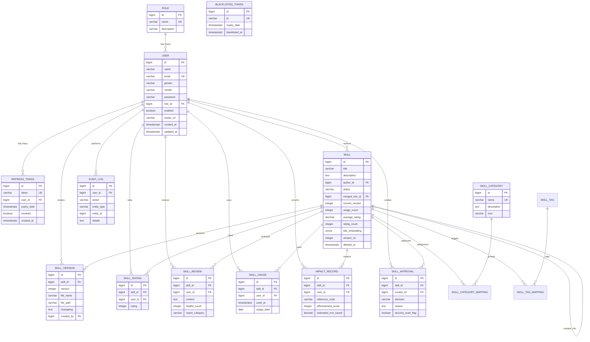
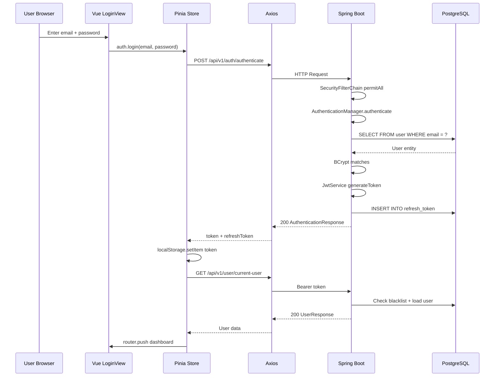
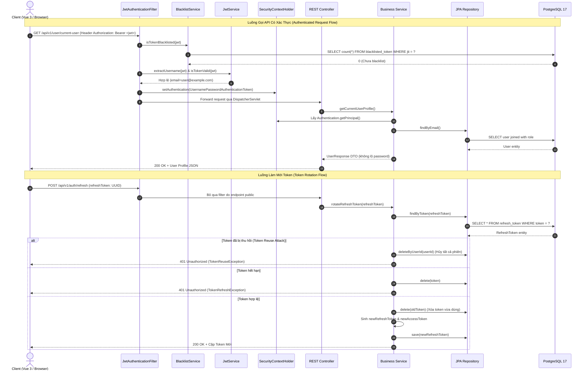
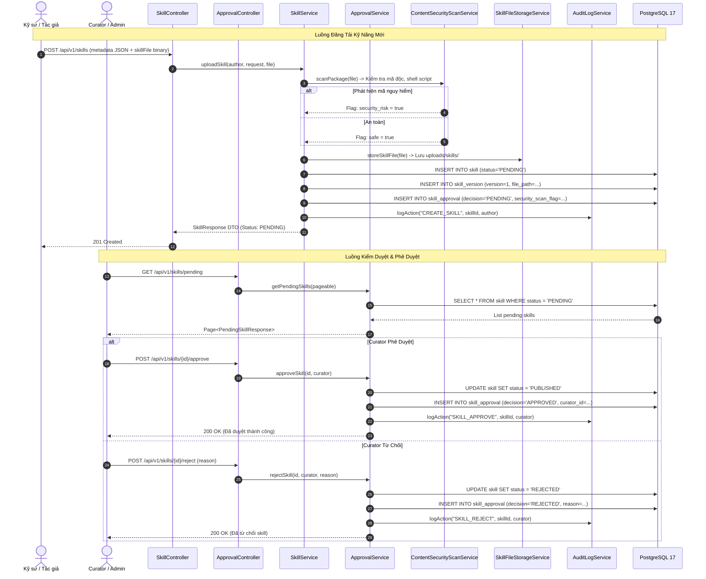
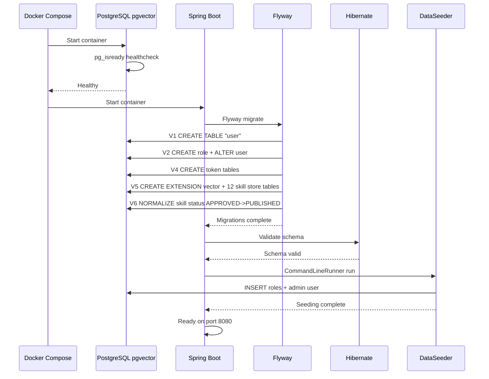

# BÁO CÁO PHÂN TÍCH CODEBASE — KIẾN TRÚC & THIẾT KẾ HỆ THỐNG

> **Tài liệu tổng hợp** — Gộp 3 file phân tích (`AI_CODEBASE_ANALYSIS.md`, `CODEBASE_ANALYSIS.md`, `CODEBASE_ANALYSIS_01.md`) thành tài liệu chủ. Ba file gốc được giữ làm lưu trữ nhưng đã bị thay thế bởi tài liệu này và `CODEBASE_ASSESSMENT_MASTER.md`.
>
> **Repository:** `skill-management-20260925`
> **Branch/commit tham chiếu:** `dev` @ `b3353b6` ("all function")
> **Ngày phân tích gốc:** 12/09/2026 · **Cập nhật gần nhất:** 28/09/2026
> **Phương pháp:** Phân tích tĩnh toàn bộ source code (đọc trực tiếp), KHÔNG truy cập runtime/database thực tế.
>
> **Tài liệu đi kèm:** `CODEBASE_ASSESSMENT_MASTER.md` (Dependency, Testing, Risks, Reading Order, Evidence Index).

---

## Mục lục

1. [Tổng quan Hệ thống](#1-tổng-quan-hệ-thống)
2. [Phạm vi & Phương pháp Phân tích](#2-phạm-vi--phương-pháp-phân-tích)
3. [Technology Stack & Yêu cầu Môi trường](#3-technology-stack--yêu-cầu-môi-trường)
4. [Cấu trúc Repository](#4-cấu-trúc-repository)
5. [Kiến trúc Backend](#5-kiến-trúc-backend)
6. [Kiến trúc Frontend](#6-kiến-trúc-frontend)
7. [Kiến trúc Database](#7-kiến-trúc-database)
8. [API & Integration Map](#8-api--integration-map)
9. [Luồng Thực thi End-to-End](#9-luồng-thực-thi-end-to-end)

---

## 1. Tổng quan Hệ thống

### 1.1 Mục đích
**Skill Management System** là nền tảng chia sẻ kỹ năng số tập trung cho các kỹ sư, kiến trúc client-server truyền thống (Layered Monolith). Hai trụ cột chức năng:
1. **Quản lý người dùng, xác thực & phân quyền** — đăng ký, đăng nhập JWT, refresh token rotation, quản lý hồ sơ, quản trị người dùng.
2. **Hệ sinh thái Quản lý & Chợ Kỹ năng Số (Skill Store)** — đăng tải, kiểm duyệt, đánh giá, đo lường tác động, kiểm toán.

### 1.2 Năng lực kinh doanh chính

| # | Năng lực | Mô tả |
|---|----------|-------|
| 1 | Xác thực & Ủy quyền | Đăng ký, đăng nhập, JWT access/refresh token, logout, logout-all, token rotation + reuse detection, blacklist |
| 2 | Quản lý hồ sơ cá nhân | Cập nhật thông tin, đổi mật khẩu, upload avatar, xóa tài khoản |
| 3 | Quản trị người dùng (Admin) | Tạo tài khoản, thay đổi vai trò, kích hoạt/khóa, reset mật khẩu, xóa user |
| 4 | Phân quyền vai trò | ADMIN, EDITOR, USER — dynamic roles từ DB; EDITOR + ADMIN đóng vai trò Curator |
| 5 | Chợ Kỹ năng (Skill Store) | Upload, versioning ngữ nghĩa, tìm kiếm/lọc đa tiêu chí, download theo phiên bản, soft delete |
| 6 | Kiểm duyệt nội dung (Curator) | Hàng đợi chờ duyệt, phê duyệt (PUBLISHED), từ chối kèm lý do, hợp nhất trùng lặp, deprecate |
| 7 | Quét an ninh mã nguồn | `ContentSecurityScanService` phát hiện shell/script độc trước khi phê duyệt |
| 8 | Tương tác cộng đồng | Đánh giá sao 1-5, nhận xét, bình chọn helpful, báo cáo vi phạm |
| 9 | Đo lường tác động | Ghi nhận usage theo ngày, impact record (giờ tiết kiệm, điểm hiệu quả) |
| 10 | Thống kê & Bảng xếp hạng | Dashboard stats, leaderboard (rating/usage/impact/contributor), stats cá nhân |
| 11 | Nhật ký kiểm toán | `audit_log` ghi nhận các hành động nhạy cảm, Admin tra cứu đa tiêu chí |
| 12 | Dọn dẹp token hết hạn | Scheduled job tự động xóa expired tokens (2:00 AM daily) |

### 1.3 Nguồn gốc & Tiến hóa
Codebase khởi nguồn từ project open-source [`User-Management-JavaSpringBoot`](https://github.com/alwinsimon/User-Management-JavaSpringBoot) của Alwin Simon (Apache 2.0). Đã được biến đổi toàn diện: migrate Java 17 → 21, Spring Boot 3.2 → 3.4.2, thêm Flyway migrations, thêm Vue 3 SPA frontend, tích hợp pgvector, xây dựng toàn bộ hệ sinh thái Skill Store (12 bảng DB, 12 controller, 17 service, 12 view).

### 1.4 Phong cách kiến trúc tổng thể
**Layered Monolith** — Backend Spring Boot monolith chia layer (Controller → Service → Repository). Frontend Vue 3 SPA giao tiếp qua REST API. Cả hai đóng gói Docker riêng, orchestrate qua `docker-compose.yml` (3 services: PostgreSQL pgvector, Backend, Frontend Nginx).

```mermaid
graph TB
    subgraph Client_Layer ["Client Tier (Vue 3 SPA - Vite :5173 / Docker :3000)"]
        SPA["Vue 3 Single Page Application"]
        NAVBAR["AppNavbar.vue (Role-based Menu & Avatar)"]
        PINIA_AUTH["Pinia Auth Store (auth.ts)"]
        PINIA_CAT["Pinia Category Store (category.ts)"]
        AXIOS["Axios Interceptors (api.ts)"]
        subgraph Views ["Vue Views"]
            V_AUTH["Auth: Login | Register"]
            V_USER["User: AccountInfo | Admin | AuditLog"]
            V_SKILL["Skill Store: SkillList | SkillDetail | SkillUpload | MySkills"]
            V_CURATOR["Curator: PendingApproval | MergeSkills"]
        end
        SPA --> NAVBAR
        SPA --> Views
        Views --> PINIA_AUTH
        Views --> PINIA_CAT
        PINIA_AUTH --> AXIOS
        PINIA_CAT --> AXIOS
    end

    subgraph Gateway_Proxy ["Web Server & Reverse Proxy"]
        NGINX["Nginx Container (port 3000 / 80)"]
        VITE_PROXY["Vite Dev Server Proxy (/api -> :8080)"]
    end

    subgraph Security_Filter_Chain ["Spring Security Filter Chain (:8080)"]
        CORS["CorsConfig (CORS Filter)"]
        JWT_FILTER["JwtAuthenticationFilter"]
        SEC_CTX["SecurityContextHolder"]
        DAO_AUTH["DaoAuthenticationProvider & BCrypt"]
    end

    subgraph Controller_Layer ["Presentation Layer (12 REST Controllers)"]
        AUTH_CTRL["AuthenticationController (/api/v1/auth)"]
        USER_CTRL["UserController (/api/v1/user)"]
        ADMIN_CTRL["AdminController (/api/v1/admin)"]
        SKILL_CTRL["SkillController (/api/v1/skills)"]
        APPROVAL_CTRL["ApprovalController (/api/v1/skills/pending|approve|reject|merge)"]
        CAT_CTRL["CategoryController (/api/v1/categories)"]
        RATING_CTRL["RatingController (/api/v1/skills/{id}/ratings)"]
        REVIEW_CTRL["ReviewController (/api/v1/skills/{id}/reviews)"]
        USAGE_CTRL["UsageController (/api/v1/skills/{id}/usage|impact)"]
        STATS_CTRL["StatsController (/api/v1/stats)"]
        AUDIT_CTRL["AuditLogController (/api/v1/audit-logs)"]
        HEALTH_CTRL["HealthController (/health)"]
    end

    subgraph Service_Layer ["Business Logic Layer"]
        AUTH_SVC["AuthenticationServiceImpl"]
        JWT_SVC["JwtServiceImpl"]
        REFRESH_SVC["RefreshTokenServiceImpl"]
        BLACKLIST_SVC["BlacklistServiceImpl"]
        USER_SVC["UserServiceImpl"]
        ADMIN_SVC["AdminServiceImpl"]
        FILE_SVC["FileStorageServiceImpl (Avatars)"]
        SKILL_SVC["SkillService"]
        APPROVAL_SVC["ApprovalService"]
        CAT_SVC["CategoryService"]
        RATING_SVC["RatingService"]
        REVIEW_SVC["ReviewService"]
        USAGE_SVC["UsageImpactService"]
        STATS_SVC["StatsService"]
        AUDIT_SVC["AuditLogService"]
        SCAN_SVC["ContentSecurityScanService"]
        SKILL_FILE_SVC["SkillFileStorageService (Packages)"]
    end

    subgraph Persistence_Layer ["Data Access & Storage"]
        USER_REPO["UserRepository / RoleRepository"]
        TOKEN_REPO["RefreshTokenRepository / BlacklistedTokenRepository"]
        SKILL_REPO["SkillRepository / SkillVersionRepository"]
        CAT_REPO["SkillCategoryRepository / SkillTagRepository"]
        APPROVAL_REPO["SkillApprovalRepository"]
        FEEDBACK_REPO["SkillRatingRepository / SkillReviewRepository"]
        USAGE_REPO["SkillUsageRepository / ImpactRecordRepository"]
        AUDIT_REPO["AuditLogRepository"]
        DISK_AVATAR["Disk: uploads/avatars/"]
        DISK_SKILL["Disk: uploads/skills/"]
        PG_DB[("PostgreSQL 17 pgvector Database")]
    end

    subgraph Background_Workers ["Schedulers & Seeders"]
        SEEDER["DataSeeder (CommandLineRunner)"]
        CLEANUP_JOB["TokenCleanupScheduler (@Scheduled 02:00 AM)"]
    end

    AXIOS -->|"HTTP REST"| NGINX
    AXIOS -.->|"Dev Proxy"| VITE_PROXY
    NGINX --> CORS
    VITE_PROXY --> CORS
    CORS --> JWT_FILTER
    JWT_FILTER -->|"Check Blacklist"| BLACKLIST_SVC
    JWT_FILTER -->|"Validate & Extract"| JWT_SVC
    JWT_FILTER -->|"Set Principal"| SEC_CTX
    JWT_FILTER --> Controller_Layer
    AUTH_CTRL --> AUTH_SVC
    AUTH_CTRL --> REFRESH_SVC
    AUTH_CTRL --> BLACKLIST_SVC
    USER_CTRL --> USER_SVC
    ADMIN_CTRL --> ADMIN_SVC
    SKILL_CTRL --> SKILL_SVC
    SKILL_CTRL --> USER_SVC
    APPROVAL_CTRL --> APPROVAL_SVC
    APPROVAL_CTRL --> USER_SVC
    CAT_CTRL --> CAT_SVC
    RATING_CTRL --> RATING_SVC
    REVIEW_CTRL --> REVIEW_SVC
    USAGE_CTRL --> USAGE_SVC
    STATS_CTRL --> STATS_SVC
    AUDIT_CTRL --> AUDIT_SVC
    SKILL_SVC --> SKILL_FILE_SVC
    SKILL_SVC --> SCAN_SVC
    SKILL_SVC --> SKILL_REPO
    SKILL_SVC --> CAT_REPO
    SKILL_SVC --> AUDIT_SVC
    APPROVAL_SVC --> APPROVAL_REPO
    APPROVAL_SVC --> SKILL_REPO
    APPROVAL_SVC --> AUDIT_SVC
    RATING_SVC --> FEEDBACK_REPO
    RATING_SVC --> SKILL_REPO
    REVIEW_SVC --> FEEDBACK_REPO
    USAGE_SVC --> USAGE_REPO
    USAGE_SVC --> SKILL_REPO
    STATS_SVC --> SKILL_REPO
    STATS_SVC --> USAGE_REPO
    STATS_SVC --> FEEDBACK_REPO
    AUTH_SVC --> DAO_AUTH
    AUTH_SVC --> JWT_SVC
    AUTH_SVC --> REFRESH_SVC
    AUTH_SVC --> USER_REPO
    USER_SVC --> FILE_SVC
    USER_SVC --> USER_REPO
    ADMIN_SVC --> USER_REPO
    ADMIN_SVC --> AUDIT_SVC
    USER_REPO --> PG_DB
    TOKEN_REPO --> PG_DB
    SKILL_REPO --> PG_DB
    CAT_REPO --> PG_DB
    APPROVAL_REPO --> PG_DB
    FEEDBACK_REPO --> PG_DB
    USAGE_REPO --> PG_DB
    AUDIT_REPO --> PG_DB
    FILE_SVC --> DISK_AVATAR
    SKILL_FILE_SVC --> DISK_SKILL
    SEEDER --> USER_REPO
    CLEANUP_JOB --> TOKEN_REPO
```



---

## 2. Phạm vi & Phương pháp Phân tích

### 2.1 Các khu vực đã kiểm tra
- **Backend:** Tất cả config, controller (12), service (17 interface + 7 impl), repository (14), model (14 entity), DTO (21), exception, scheduler.
- **Frontend:** Tất cả views (12), stores (2), services (9), types (2), composables, components, router, assets.
- **Database:** 5 Flyway migrations (V1, V2, V4, V5, V6 — V3 đã gỡ), 16 bảng.
- **Docker:** `docker-compose.yml`, backend `Dockerfile`, frontend `Dockerfile`, `nginx.conf`.
- **Build:** `pom.xml`, `package.json`, `vite.config.ts`, `tsconfig*.json`, `eslint.config.ts`.
- **Tests:** 22 backend test files, 2 frontend test files, test config `application-test.yml`.
- **Config:** `.env.example`, `.gitignore`, `application.yml`.

### 2.2 Các khu vực loại trừ

| Thư mục | Lý do loại trừ |
|---------|---------------|
| `node_modules/` | Dependencies đã cài đặt, không phải project code |
| `target/` | Build output của Maven |
| `dist/` | Build output của Vite |
| `.git/` | Git metadata |
| `.idea/` | IntelliJ IDEA config |
| `.ua/` | Understand Anything metadata cũ |
| `backend/uploads/` | Runtime upload directory |
| `.mvn/` | Maven wrapper files |

### 2.3 Giới hạn quan trọng
- **Không truy cập database runtime** — Không thể xác minh schema thực tế, dữ liệu, query performance.
- **Không chạy test** — Kết quả test coverage dựa trên suy luận từ file structure.
- **Không truy cập CI/CD** — Không tìm thấy file CI/CD trong repository.

### 2.4 Đánh giá sự thật vs suy luận

| Loại | Ví dụ |
|------|-------|
| **Verified** (Từ source code) | Database schema, API endpoints, security config, business logic |
| **Inferred** (Suy luận hợp lý) | Runtime behavior, actual query performance, token expiration behavior |
| **Not verified at runtime** | Database indexes performance, HikariCP pool behavior, virtual threads behavior |

---

## 3. Technology Stack & Yêu cầu Môi trường

### 3.1 Backend (Java 21 + Spring Boot)

| Component | Detail |
|-----------|--------|
| Java | 21 LTS (Records, Pattern Matching, Virtual Threads enabled) |
| Spring Boot | 3.4.2 (parent POM) |
| Spring Security | 6.4.x (via Spring Boot parent) |
| Spring Data JPA | Via `spring-boot-starter-data-jpa`, Hibernate 6 |
| Bean Validation | Via `spring-boot-starter-validation` |
| Spring Actuator | Health + Info endpoints exposed |
| JWT | jjwt 0.12.6 (jjwt-api, jjwt-impl, jjwt-jackson), HMAC-SHA256 |
| Lombok | Optional, used for JPA entities only |
| Flyway | `flyway-core` + `flyway-database-postgresql` |
| pgvector driver | `com.pgvector:pgvector:0.1.6` |
| PostgreSQL Driver | Runtime scope |
| Build | Maven (wrapper included) |

### 3.2 Frontend (Vue Stack)

| Component | Detail |
|-----------|--------|
| Vue | 3.5.40 (Composition API, `<script setup>`) |
| TypeScript | 6.0 |
| Vite | 8.1.5 (dev server + build) |
| Pinia | 4.0.2 (state management) |
| Element Plus | 2.14.5 (UI components) + `@element-plus/icons-vue` 2.3.2 |
| Axios | 1.20.0 (HTTP client) |
| Vue Router | 5.2.0 |
| Vitest | 4.1.10 (unit tests) + `@vue/test-utils` 2.4.11, JSDOM 29.1.1 |
| ESLint | 10.7.0 + OxLint 1.74.0 |
| Prettier | 3.9.5 |
| Node.js | `^22.18.0 \|\| >=24.12.0` |

### 3.3 Database (PostgreSQL 17 Stack)

| Component | Detail |
|-----------|--------|
| Image | `pgvector/pgvector:pg17` (Docker, hỗ trợ pgvector extension) |
| Database | `skill_management_db` |
| Port | 5433 (host) → 5432 (container), local dev; 5432 (compose network) |
| Migration | Flyway (5 migrations: V1, V2, V4, V5, V6) |
| Vector Extension | pgvector — cột `title_embedding vector(384)` trên bảng `skill` |
| Init Script | `postgresql_17_init_and_data.sql` (schema + dữ liệu mẫu) |

### 3.4 Lệnh chạy cục bộ

**Database:**
```bash
docker compose up -d
```

**Backend** (http://localhost:8080):
```bash
cd backend
mvnw.cmd spring-boot:run        # Windows
./mvnw spring-boot:run          # Unix
```

**Frontend** (http://localhost:5173):
```bash
cd frontend
npm install
npm run dev
```

**All-in-One (Docker):**
```bash
docker compose up --build -d
```

**Tests:**
```bash
cd backend && mvnw.cmd test     # Backend
cd frontend && npm run test:unit # Frontend
```

**Build:**
```bash
cd backend && mvnw.cmd package -DskipTests   # Backend → target/*.jar
cd frontend && npm run build                 # Frontend → dist/
docker compose up --build                    # Docker (tất cả)
```

---

## 4. Cấu trúc Repository

### 4.1 Cây thư mục (annotate chi tiết)

```
skill-management/
├── .env.example                              # Mẫu biến môi trường (DB, JWT, CORS, ports)
├── .gitignore                                # Git ignore rules
├── README.md                                 # Hướng dẫn setup & API docs
├── LICENSE                                   # Apache 2.0
├── docker-compose.yml                        # Docker orchestration (3 services: pgvector, backend, frontend)
├── postgresql_17_init_and_data.sql           # Script khởi tạo schema + dữ liệu mẫu PG17
│
├── backend/                                  # Spring Boot 3.4.2 API
│   ├── Dockerfile                            # Multi-stage Docker build (temurin:21-jdk -> temurin:21-jre)
│   ├── pom.xml                               # Maven dependencies
│   ├── mvnw / mvnw.cmd                       # Maven wrapper cross-platform
│   └── src/
│       ├── main/java/com/skillmanagement/
│       │   ├── SkillManagementApplication.java   # Entry point, @SpringBootApplication, @EnableScheduling
│       │   ├── config/                            # Spring config, security, CORS, seeder
│       │   │   ├── ApplicationConfig.java         # UserDetailsService, PasswordEncoder, AuthProvider, AuthManager
│       │   │   ├── CorsConfig.java                # CORS for Spring MVC + Security
│       │   │   ├── DataSeeder.java                # CommandLineRunner seed data (3 roles + admin account)
│       │   │   ├── SecurityConfig.java            # SecurityFilterChain (CSRF disabled, stateless sessions)
│       │   │   ├── WebMvcConfig.java              # Static resource handler for uploads
│       │   │   └── filter/
│       │   │       └── JwtAuthenticationFilter.java  # OncePerRequestFilter for JWT
│       │   ├── controller/                        # 12 REST controllers
│       │   │   ├── AdminController.java           # /api/v1/admin/** (@Secured ROLE_ADMIN)
│       │   │   ├── ApprovalController.java        # /api/v1/skills (pending, approve, reject, merge) — Curator
│       │   │   ├── AuditLogController.java        # /api/v1/audit-logs (Admin only)
│       │   │   ├── AuthenticationController.java  # /api/v1/auth/**
│       │   │   ├── CategoryController.java        # /api/v1/categories
│       │   │   ├── HealthController.java          # /health
│       │   │   ├── RatingController.java          # /api/v1/skills/{id}/ratings
│       │   │   ├── ReviewController.java          # /api/v1/skills/{id}/reviews + /api/v1/reviews/{id}
│       │   │   ├── SkillController.java          # /api/v1/skills (upload, list, detail, download, versions, deprecate)
│       │   │   ├── StatsController.java          # /api/v1/stats (dashboard, leaderboard, my)
│       │   │   ├── UsageController.java          # /api/v1/skills/{id}/usage + /impact
│       │   │   └── UserController.java           # /api/v1/user/**
│       │   ├── dto/                               # 21 Java Records (request/response)
│       │   ├── exception/                         # GlobalExceptionHandler + 4 custom exceptions
│       │   ├── model/                             # 14 JPA entities
│       │   ├── repository/                        # 14 Spring Data repositories
│       │   ├── scheduler/                         # TokenCleanupScheduler
│       │   └── service/                           # 17 interfaces + 7 impl
│       ├── main/resources/
│       │   ├── application.yml                    # App config (Datasource, JWT, CORS, Upload)
│       │   └── db/migration/                      # 5 Flyway SQL migrations (V1, V2, V4, V5, V6 — V3 đã gỡ)
│       └── test/                                  # 22 test classes + test config (application-test.yml)
│
├── frontend/                                 # Vue 3 SPA
│   ├── Dockerfile                            # Multi-stage Docker build (Node 22 -> Nginx Alpine)
│   ├── package.json                          # NPM dependencies
│   ├── vite.config.ts                        # Vite config + API proxy
│   ├── nginx.conf                            # Production Nginx config
│   └── src/
│       ├── main.ts                           # Entry point
│       ├── App.vue                           # Root component (AppNavbar + RouterView)
│       ├── router/index.ts                   # Vue Router + navigation guards
│       ├── stores/                           # 2 Pinia stores (auth, category) + __tests__
│       ├── services/                         # 9 API service modules + __tests__
│       ├── types/                            # 2 TypeScript type files (index, skill)
│       ├── components/layout/                # AppNavbar.vue
│       ├── views/                            # 12 page components
│       └── assets/main.css                   # Global styles
│
└── docs/                                     # Documentation
    ├── AI_CODEBASE_ANALYSIS.md               # (đã thay thế — lưu trữ)
    ├── AIX - AI-Skill Store.md               # Đặc tả Skill Store
    ├── DATABASE_SETUP_GUIDE_PG17.md
    ├── postgresql_17_init_and_data.sql
    └── superpowers/                          # Plans & specs (design history)
        ├── plans/
        └── specs/
```

### 4.2 Module map

| Module | Trách nhiệm |
|--------|-------------|
| `backend/config/` | Spring Security, CORS, WebMVC, data seeding, JWT filter |
| `backend/controller/` | REST API endpoints (Auth, User, Admin, Health, Skill, Approval, Category, Rating, Review, Usage, Stats, AuditLog) |
| `backend/dto/` | Request/Response data transfer objects (Java Records) |
| `backend/model/` | JPA entities (User, Role, RefreshToken, BlacklistedToken, Skill, SkillVersion, SkillCategory, SkillTag, SkillRating, SkillReview, SkillUsage, SkillApproval, ImpactRecord, AuditLog) |
| `backend/repository/` | Spring Data JPA repositories |
| `backend/service/` | Business logic interfaces (17) |
| `backend/service/impl/` | Business logic implementations (7: Auth, Jwt, RefreshToken, Blacklist, Admin, User, FileStorage) |
| `backend/exception/` | Global exception handler + custom exceptions |
| `backend/scheduler/` | Scheduled token cleanup |
| `frontend/router/` | Vue Router configuration + guards (requiresAuth/Admin/Curator) |
| `frontend/stores/` | Pinia state management (auth, category) |
| `frontend/services/` | Axios API client modules (9) |
| `frontend/types/` | TypeScript type definitions (index, skill) |
| `frontend/views/` | Page-level Vue components (12) |
| `frontend/components/layout/` | AppNavbar.vue (shared navbar) |

---

## 5. Kiến trúc Backend

### 5.1 Application Entry Points
- **Main class:** `backend/src/main/java/com/skillmanagement`
- Annotations: `@SpringBootApplication`, `@EnableScheduling`
- Virtual threads enabled via `spring.threads.virtual.enabled: true` (`application.yml`)
- Data seeding on startup via `DataSeeder.java` (`CommandLineRunner`):
  - Tạo 3 vai trò mặc định: `ADMIN`, `EDITOR`, `USER`
  - Tạo tài khoản admin mặc định: `admin@gmail.com` / `password`

### 5.2 Package / Module Architecture

```
com.skillmanagement
├── config/                     # Infrastructure configuration
│   ├── ApplicationConfig       # UserDetailsService, PasswordEncoder, AuthProvider, AuthManager
│   ├── SecurityConfig          # SecurityFilterChain (CSRF disabled, stateless sessions)
│   ├── CorsConfig              # CORS for Spring MVC + Security
│   ├── WebMvcConfig            # Static resource handler for uploads
│   ├── DataSeeder              # CommandLineRunner seed data
│   └── filter/
│       └── JwtAuthenticationFilter  # OncePerRequestFilter for JWT
├── controller/                 # REST API layer (12 controllers)
├── dto/                        # Data Transfer Objects (21 Java Records)
├── model/                      # JPA Entities (14)
├── repository/                 # Spring Data JPA Repositories (14)
├── service/                    # Service Interfaces (17)
│   └── impl/                   # Service Implementations (7)
├── exception/                  # Exception handling
│   ├── GlobalExceptionHandler  # @RestControllerAdvice
│   ├── BadRequestException     # Custom RuntimeException (HTTP 400)
│   ├── ResourceNotFoundException # Custom RuntimeException (HTTP 404)
│   ├── TokenRefreshException   # Custom RuntimeException
│   └── TokenReuseException     # Custom RuntimeException
└── scheduler/
    └── TokenCleanupScheduler   # @Scheduled cron job
```

**Architectural pattern:** Layered architecture (Controller → Service Interface → Service Impl → Repository → Entity). Skill Store services (SkillService, ApprovalService, RatingService, ReviewService, UsageImpactService, StatsService, AuditLogService, CategoryService, ContentSecurityScanService, SkillFileStorageService) chỉ có interface, không có `*Impl` riêng — logic nằm trực tiếp trong class implement interface.

### 5.3 API Layer

#### REST Endpoints (chi tiết tại Section 8)

Tổng cộng 50+ endpoint trên 12 controller, trải đều các nhóm: Auth, User, Admin, Skill, Approval, Category, Rating, Review, Usage, Stats, Audit, Health.

#### Request/Response DTOs (Java Records)
Tất cả DTO sử dụng **Java Records** với **Bean Validation**:

| DTO Group | Records | Validation |
|-----------|---------|------------|
| `AuthenticationRequest` | Request | `@NotBlank` email/password, `@Email` |
| `RegisterRequest` | Request | `@NotBlank` name/email/password, `@Email`, `@Size(min=8)` password |
| `AuthenticationResponse` | Response | Backward-compatible: `token`, `accessToken`, `refreshToken`, `tokenType` |
| `CreateUserRequest` | Request | `@NotBlank` name/email/password, `@NotNull` roleId, `@Size(min=8)` |
| `UpdateProfileRequest` | Request | `@NotBlank` name |
| `ChangePasswordRequest` | Request | `@NotBlank` oldPassword/newPassword, `@Size(min=8)` newPassword |
| `RefreshTokenRequest` | Request | `@NotBlank` refreshToken |
| `LogoutRequest` | Request | Optional refreshToken |
| `UpdateRoleRequest` | Request | `@NotNull` roleId |
| `UpdateStatusRequest` | Request | `@NotNull` enabled |
| `UserResponse` | Response | Factory method `from(User)` |
| `MessageResponse` | Response | Simple message wrapper |
| `ResetPasswordResponse` | Response | Returns generated password |
| `SkillDto` | Mixed | `SkillUploadRequest`, `SkillUpdateRequest`, `SkillResponse`, `SkillVersionResponse` |
| `ApprovalDto` | Mixed | `PendingSkillResponse`, `RejectRequest`, `MergeSkillsRequest`, `DeprecateRequest` |
| `CategoryDto` | Mixed | `CategoryResponse`, `CategoryCreateRequest`, `CategoryUpdateRequest` |
| `RatingDto` | Mixed | `RatingRequest` (1-5), `RatingResponse` |
| `ReviewDto` | Mixed | `ReviewCreateRequest`, `ReviewUpdateRequest`, `ReviewResponse`, `ReviewReportRequest` |
| `UsageDto` | Mixed | `UsageRecordResponse`, `ImpactRecordRequest`, `ImpactRecordResponse` |
| `StatsDto` | Mixed | `DashboardStatsResponse`, `LeaderboardResponse`, `MySkillsStatsResponse` |
| `AuditLogDto` | Response | `AuditLogResponse` |

#### Serialization
- Jackson (mặc định Spring Boot)
- `@JsonIgnore` trên `User.password` và `User.getPassword()` — Không leak mật khẩu qua API

#### Global Exception Handling
`GlobalExceptionHandler.java` — `@RestControllerAdvice`:

| Exception | HTTP Status | Message |
|-----------|-------------|---------|
| `MethodArgumentNotValidException` | 400 | Field-level validation errors |
| `BadCredentialsException` | 401 | "Email hoặc mật khẩu không chính xác." |
| `DisabledException` | 403 | "Tài khoản đã bị khóa..." |
| `UsernameNotFoundException` | 404 | Dynamic message |
| `IllegalArgumentException` | 400 | Dynamic message |
| `AccessDeniedException` | 403 | "Bạn không có quyền..." |
| `TokenRefreshException` | 401 | Dynamic message |
| `TokenReuseException` | 401 | Dynamic message |
| `Exception` (catch-all) | 500 | "Đã xảy ra lỗi máy chủ: ..." |

Error payload format:
```json
{
  "timestamp": "...",
  "status": 400,
  "error": "Bad Request",
  "message": "...",
  "details": { }
}
```

### 5.4 Security Model

#### Authentication Flow
1. **Stateless JWT** — Không có HTTP sessions (`SessionCreationPolicy.STATELESS`)
2. **Access Token**: JWT signed với HMAC-SHA256, TTL 15 phút (900,000ms)
3. **Refresh Token**: UUID string, stored in DB, TTL 7 ngày (604,800,000ms)
4. **Token Rotation**: Mỗi lần refresh, old token bị xóa, new token được tạo
5. **Token Reuse Detection**: Nếu refresh token đã bị revoke mà bị reuse → xóa TẤT CẢ refresh tokens của user (security alert)
6. **Token Blacklist**: Access token bị blacklist khi logout (lưu JTI vào DB)
7. **Password Encoding**: BCrypt

#### Security Filter Chain
`SecurityConfig.java`:
```
CORS → CSRF (disabled) → URL Authorization → Stateless Session → JwtAuthenticationFilter
```

**Public endpoints:** `/api/v1/auth/**`, `/health/**`, `/actuator/**`, `/uploads/**`
**Authenticated:** Tất cả các request khác

#### Authorization Model
- **Method-level security** via `@EnableMethodSecurity(securedEnabled = true, prePostEnabled = true)`
- `AdminController`: Class-level `@Secured("ROLE_ADMIN")`
- `UserController`: Implicit authentication (any authenticated user)
- Roles stored in `role` table, mapped via `User.role.toAuthority()` → `"ROLE_" + name`

#### CORS Configuration
`CorsConfig.java`:
- Origins: Configurable via `CORS_ORIGINS` env var (default: `http://localhost:5173`)
- Methods: GET, POST, PUT, DELETE, OPTIONS, PATCH
- Credentials: Allowed
- Max Age: 3600s

#### Secrets / Configuration

| Key | Default | Source |
|-----|---------|--------|
| `jwt.secret-key` | `[REDACTED]` (base64 dev key) | `JWT_SECRET` env var |
| `jwt.expiration` | 900000 (15 min) | `JWT_EXPIRATION` env var |
| `jwt.refresh-expiration` | 604800000 (7 days) | `JWT_REFRESH_EXPIRATION` env var |
| `spring.datasource.password` | `postgres` | `DB_PASSWORD` env var |

> **Security note:** File `.env.example` chứa JWT secret mặc định — đây là dev-only value cần override trong production.

### 5.5 Service Layer

| Service | Interface | Implementation | Trách nhiệm |
|---------|-----------|---------------|-------------|
| AuthenticationService | `AuthenticationService.java` | `AuthenticationServiceImpl.java` | Register, authenticate |
| JwtService | `JwtService.java` | `JwtServiceImpl.java` | Token generation, validation, claim extraction |
| RefreshTokenService | `RefreshTokenService.java` | `RefreshTokenServiceImpl.java` | Create, rotate, revoke refresh tokens |
| BlacklistService | `BlacklistService.java` | `BlacklistServiceImpl.java` | Blacklist/check access tokens |
| AdminService | `AdminService.java` | `AdminServiceImpl.java` | User CRUD, role/status management |
| UserService | `UserService.java` | `UserServiceImpl.java` | Profile, password, avatar, account deletion |
| FileStorageService | `FileStorageService.java` | `FileStorageServiceImpl.java` | File upload/delete (avatars) |
| SkillService | `SkillService.java` | *(same class)* | Upload, version, search (visibility + sort), detail, download, soft delete, `findSimilarSkills` (327 LOC) |
| ApprovalService | `ApprovalService.java` | *(same class)* | Pending list, approve, reject, merge skills |
| CategoryService | `CategoryService.java` | *(same class)* | CRUD skill categories |
| ContentSecurityScanService | `ContentSecurityScanService.java` | *(same class)* | Quét an ninh mã nguồn tải lên |
| SkillFileStorageService | `SkillFileStorageService.java` | *(same class)* | Lưu trữ/phân phối file gói kỹ năng |
| RatingService | `RatingService.java` | *(same class)* | Chấm sao, tính average_rating |
| ReviewService | `ReviewService.java` | *(same class)* | Nhận xét, helpful vote, report |
| UsageImpactService | `UsageImpactService.java` | *(same class)* | Ghi nhận usage, đo lường impact |
| StatsService | `StatsService.java` | *(same class)* | Dashboard stats, leaderboard, my stats |
| AuditLogService | `AuditLogService.java` | *(same class)* | Ghi nhận & tra cứu nhật ký kiểm toán |

#### Transaction Boundaries
- `@Transactional` trên các method write: `createUser`, `updateUserRole`, `updateUserStatus`, `resetPassword`, `deleteUserById`, `deleteUserByEmail`, `updateProfile`, `changePassword`, `updateAvatar`, `deleteOwnAccount`, `blacklistToken`, `createRefreshToken`, `rotateRefreshToken`, `revokeToken`, `revokeAllUserTokens`, `purgeExpiredTokens`
- `@Transactional(readOnly = true)` trên: `isTokenBlacklisted`

#### Business Rules
1. **Self-protection:** Admin không thể tự khóa hoặc tự xóa tài khoản của chính mình
2. **Admin role protection:** Không thể thay đổi hoặc hạ cấp vai trò của tài khoản Admin
3. **Admin deletion prevention:** Tài khoản Admin không thể tự xóa (user-initiated)
4. **Email uniqueness:** Enforced cả ở DB constraint và application validation
5. **File upload (avatar):** Chỉ chấp nhận JPG, PNG, WEBP, tối đa 5MB
6. **Password policy:** Minimum 8 ký tự (Bean Validation)
7. **Skill ownership:** Chỉ Author hoặc Curator (ADMIN/EDITOR) mới được update/xóa skill
8. **Curator role:** ADMIN + EDITOR có quyền kiểm duyệt (approve/reject/merge/deprecate)
9. **Skill rating:** Mỗi user chỉ có 1 đánh giá sao trên mỗi skill (UNIQUE constraint)
10. **Skill usage:** Mỗi user chỉ ghi nhận 1 lượt sử dụng skill/ngày (UNIQUE constraint)
11. **Soft delete:** Skill xóa bằng `deleted_at` (khóa vật lý), không xóa khỏi DB
12. **Optimistic locking:** Bảng `skill` có `version_no` để chống concurrent modification
13. **Token reuse detection:** Refresh token bị reuse → xóa TẤT CẢ refresh tokens của user
14. **Skill visibility:** Skill `PENDING`/`REJECTED` chỉ visible cho author hoặc Curator/Admin; `PUBLISHED`/`DEPRECATED`/`MERGED` visible cho mọi user đã xác thực. Áp dụng cho list, detail, download, versions.
15. **Re-approval on update:** Khi `updateSkill` upload file mới → status reset về `PENDING` (cần Curator duyệt lại).

### 5.6 Persistence Layer
Xem chi tiết tại Section 7 — Database Architecture.

### 5.7 Async / Scheduling

#### Token Cleanup Scheduler
`TokenCleanupScheduler.java`:
- Cron: `0 0 2 * * ?` (2:00 AM hàng ngày, configurable via `jwt.cleanup.cron`)
- Xóa expired refresh tokens (`refresh_token.expiry_date < NOW()`)
- Xóa expired blacklisted tokens (`blacklisted_token.expiry_date < NOW()`)
- Logging: Ghi log số lượng tokens đã xóa

### 5.8 File Storage Integration

**Avatar Storage** — `FileStorageServiceImpl.java`:
- Storage: **Local disk** (`uploads/avatars/` directory)
- Naming: `avatar_{userId}_{timestamp}.{ext}`
- Serving: Static resource handler qua `WebMvcConfig.java` → `/uploads/avatars/**`
- Cleanup: Old avatar deleted trước khi lưu avatar mới
- Docker volume: `backend_uploads` mounted at `/app/uploads`

**Skill Package Storage** — `SkillFileStorageService.java`:
- Storage: **Local disk** (`uploads/skills/` directory)
- Naming: Theo skill/version metadata
- Serving: Stream download qua `SkillController` (binary response)
- Security: Quét an ninh qua `ContentSecurityScanService` trước khi lưu

### 5.9 Observability

| Aspect | Implementation |
|--------|---------------|
| Health Check | Custom `/health` endpoint + `/actuator/health` |
| Actuator | `health`, `info` endpoints exposed |
| Logging | SLF4J via Lombok `@Slf4j` (token operations, cleanup, security alerts) |
| Metrics | Spring Actuator (basic) |
| SQL Logging | `show-sql: false`, `format_sql: true` (for debug) |

---

## 6. Kiến trúc Frontend

### 6.1 Application Bootstrap
`main.ts`:
1. Import global CSS (`main.css` — Inter font, box-sizing reset)
2. Create Vue app
3. Register all Element Plus icons globally
4. Install Pinia, Vue Router, Element Plus
5. Mount `#app`

`App.vue`: Minimal — chỉ chứa `<RouterView />`.

### 6.2 Routing and Route Guards
`router/index.ts`:

| Path | Name | Component | Meta | Guard |
|------|------|-----------|------|-------|
| `/` | — | (redirect) | — | → `/dashboard` |
| `/login` | login | `LoginView.vue` | `requiresGuest: true` | Redirect to `/dashboard` if authenticated |
| `/register` | register | `RegisterView.vue` | `requiresGuest: true` | Redirect to `/dashboard` if authenticated |
| `/dashboard` | dashboard | `DashboardView.vue` | `requiresAuth: true` | Redirect to `/login` if not authenticated |
| `/account` | account | `AccountInfoView.vue` | `requiresAuth: true` | Redirect to `/login` if not authenticated |
| `/skills` | skills | `SkillListView.vue` | `requiresAuth: true` | Redirect to `/login` if not authenticated |
| `/skills/upload` | skill-upload | `SkillUploadView.vue` | `requiresAuth: true` | Redirect to `/login` if not authenticated |
| `/skills/my` | my-skills | `MySkillsView.vue` | `requiresAuth: true` | Redirect to `/login` if not authenticated |
| `/skills/:id` | skill-detail | `SkillDetailView.vue` | `requiresAuth: true` | Redirect to `/login` if not authenticated |
| `/curator/pending` | curator-pending | `PendingApprovalView.vue` | `requiresAuth: true, requiresCurator: true` | Redirect to `/dashboard` if not curator |
| `/curator/merge` | curator-merge | `MergeSkillsView.vue` | `requiresAuth: true, requiresCurator: true` | Redirect to `/dashboard` if not curator |
| `/admin` | admin | `AdminView.vue` | `requiresAuth: true, requiresAdmin: true` | Redirect to `/dashboard` if not admin |
| `/admin/audit` | admin-audit | `AuditLogView.vue` | `requiresAuth: true, requiresAdmin: true` | Redirect to `/dashboard` if not admin |

**Navigation Guard logic** (`router.beforeEach`):
1. Nếu có token nhưng chưa fetch user → `auth.fetchCurrentUser()`
2. `requiresAuth` + not authenticated → redirect `/login`
3. `requiresGuest` + authenticated → redirect `/dashboard`
4. `requiresAdmin` + not admin → redirect `/dashboard`
5. `requiresCurator` + not curator → redirect `/dashboard`

### 6.3 Page/Component Structure

| View | File | Chức năng |
|------|------|-----------|
| Login | `LoginView.vue` | Form đăng nhập (email + password) |
| Register | `RegisterView.vue` | Form đăng ký (name, email, password, gender, mobile) |
| Dashboard | `DashboardView.vue` | Trang chính, thống kê hệ thống, leaderboard, navigation |
| Account | `AccountInfoView.vue` | Quản lý profile, avatar, đổi password, xóa account |
| Admin | `AdminView.vue` | Bảng user management, tạo user, đổi role/status, reset password, xóa user |
| Audit Log | `AuditLogView.vue` | Tra cứu nhật ký kiểm toán (Admin only) |
| Skill List | `SkillListView.vue` | Chợ kỹ năng, tìm kiếm, lọc danh mục, phân trang |
| Skill Detail | `SkillDetailView.vue` | Chi tiết kỹ năng, download, đánh giá sao, nhận xét |
| Skill Upload | `SkillUploadView.vue` | Đăng tải kỹ năng mới kèm file và metadata |
| My Skills | `MySkillsView.vue` | Quản lý danh sách kỹ năng của chính mình |
| Pending Approval | `PendingApprovalView.vue` | Hàng đợi kiểm duyệt kỹ năng (Curator) |
| Merge Skills | `MergeSkillsView.vue` | Hợp nhất các kỹ năng trùng lặp (Curator) |

**Shared Layout:** `AppNavbar.vue` — Thanh điều hướng trên cùng, hiển thị menu theo vai trò (role-based), avatar. Mounted trong `App.vue`.

**UI Components:** Sử dụng Element Plus components: `ElForm`, `ElTable`, `ElDialog`, `ElMessage`, `ElMessageBox`, `ElUpload`, `ElAvatar`, `ElTag`, `ElSwitch`, `ElSelect`, `ElRate`, `ElPagination`, `ElSkeleton`, etc.

### 6.4 State Management

**`stores/auth.ts`** — Pinia Setup Store:

| State | Type | Persistence |
|-------|------|-------------|
| `token` | `string \| null` | `localStorage` key `"token"` |
| `refreshToken` | `string \| null` | `localStorage` key `"refreshToken"` |
| `user` | `UserResponse \| null` | In-memory only |
| `loading` | `boolean` | In-memory only |

| Computed | Logic |
|----------|-------|
| `isAuthenticated` | `!!token.value` |
| `isAdmin` | `user.value?.role?.name === 'ADMIN'` |
| `isEditor` | `user.value?.role?.name === 'EDITOR'` |
| `isCurator` | `isAdmin.value \|\| isEditor.value` |

| Action | Behavior |
|--------|----------|
| `canManageSkill(authorId?)` | Curator → true; else check `user.id === authorId` |
| `register()` | Call API → redirect `/login` (no auto-login) |
| `login()` | Call API → store token + refreshToken in localStorage → fetchCurrentUser → redirect `/dashboard` |
| `fetchCurrentUser()` | Call API → set `user` — on failure → `clearSession()` + redirect `/login` |
| `logout()` | Call backend `authService.logout(refreshToken)` → `clearSession()` (token, refreshToken, user, localStorage) → redirect `/login` |

> **Resolved (2026-09-28):** `auth.logout()` giờ gọi backend `/api/v1/auth/logout` (blacklist access + revoke refresh) trước khi clear client state. `refreshToken` được lưu vào state + localStorage. **Vẫn chưa resolved:** Axios 401 interceptor vẫn chưa implement refresh-on-401 flow (xem 6.5).

**`stores/category.ts`** — Pinia Setup Store:
- Quản lý danh mục kỹ năng, nạp danh mục cho bộ lọc
- Caching danh mục để tránh gọi API lặp lại

### 6.5 API Client and Authentication Flow
`services/api.ts`:

- **Base URL:** `/api/v1` (proxied by Vite dev server / Nginx in production)
- **Request interceptor:** Attach `Bearer {token}` từ `localStorage`
- **Response interceptor:** 401 → clear `token` + `refreshToken` localStorage → redirect `window.location.href = '/login'`

> **Observed:** 401 interceptor vẫn sử dụng `window.location.href` (hard redirect, full page reload) và **chưa** implement refresh-on-401 flow — khi access token hết hạn, user bị logout ngay dù `refreshToken` đã được lưu. Cần thêm retry-with-refresh logic trong interceptor.

#### API Service Modules

| Module | File | Endpoints |
|--------|------|-----------|
| `authService` | `authService.ts` | register, login, logout, getCurrentUser, getAllUsers*, deleteUser* |
| `userService` | `userService.ts` | getCurrentUser, updateProfile, changePassword, uploadAvatar, deleteAccount |
| `adminService` | `adminService.ts` | getRoles, getAllUsers, createUser, updateRole, updateStatus, resetPassword, deleteUser, deleteUserById |
| `skillService` | `skillService.ts` | getSkills, getMySkills, getSimilarSkills, getSkill, uploadSkill, updateSkill, deleteSkill, getVersions, downloadSkill, deprecateSkill, rateSkill, getMyRating, getReviews, createReview, updateReview, deleteReview, voteHelpful, reportReview, recordUsage, recordImpact, getSkillImpacts |
| `approvalService` | `approvalService.ts` | getPendingSkills, approveSkill, rejectSkill, mergeSkills |
| `curatorService` | `curatorService.ts` | Nghiệp vụ kiểm duyệt |
| `categoryService` | `categoryService.ts` | CRUD danh mục |
| `statsService` | `statsService.ts` | getDashboardStats, getLeaderboard, getMyStats |
| `auditLogService` | `auditLogService.ts` | getAuditLogs (tra cứu nhật ký kiểm toán) |

> *`authService.getAllUsers()` và `authService.deleteUser()` duplicate functionality trong `adminService` — technical debt.

### 6.6 UI Permission Model
- **Route-level:** `meta.requiresAuth`, `meta.requiresAdmin`, `meta.requiresCurator` trong router guard → redirect users không đủ quyền
- **Component-level:** `v-if="auth.isAdmin"` hiển thị nút "Quản trị" trên navbar; `v-if="auth.isCurator"` hiển thị menu kiểm duyệt
- **Skill ownership:** `auth.canManageSkill(authorId)` kiểm soát nút update/delete trên skill
- **Admin view:**
  - Admin role users: Role select disabled + tooltip giải thích
  - Self-status: Switch disabled + tooltip, nút Xóa disabled
  - Self: Nút "Xóa" disabled cho current user
- **Curator views:** PendingApprovalView, MergeSkillsView chỉ hiển thị khi `isCurator`

### 6.7 Form and Validation
- **Client-side:** Manual validation trong `handleXxx()` functions sử dụng `ElMessage.warning()`
  - LoginView: Không có client validation (dựa vào backend)
  - RegisterView: Không có client validation (dựa vào backend)
  - AccountInfoView: Check empty name, password length >= 8, confirm password match
  - AdminView: Check empty name/email, password length, roleId
- **Server-side:** Bean Validation annotations trên DTOs
- **Gap:** Frontend không sử dụng Element Plus form validation rules (`el-form :rules`), mà dùng imperative checks.

### 6.8 Error/Loading Handling
- **Loading:** Ref variables (`loading`, `profileLoading`, `passwordLoading`, `avatarLoading`, `deleteLoading`) bound to button `:loading`
- **Error display:** `ElMessage.error()` với `error.response?.data?.message` fallback
- **Success display:** `ElMessage.success()`
- **Skeleton:** `el-skeleton` trên Dashboard khi user chưa load

### 6.9 Frontend Testing
- **Framework:** Vitest 4.1.10 + `@vue/test-utils`
- **Test files (2):**
  - `stores/__tests__/auth.spec.ts` — 2 tests: Default state initialization, logout state clearing; mocks `vue-router`
  - `services/__tests__/contracts.spec.ts` — 3 tests: skill update gửi multipart metadata, pending records đọc từ paginated response, mapping dashboard/leaderboard/my-stats từ backend fields; mock `api`
- **Coverage:** Thấp — 2 file test cho 1 store + 1 service contract, không có tests cho views/router

### 6.10 Frontend Build Pipeline
- **Dev:** `vite` dev server (port 5173) with proxy for `/api`, `/health`, `/uploads`
- **Build:** `vite build` (via `npm run build-only` hoặc `npm run build` with type-check)
- **Lint:** OxLint + ESLint (dual linter setup)
- **Format:** Prettier
- **Type check:** `vue-tsc --build`
- **Production:** Nginx serving static files + proxy API to backend

### 6.11 Cross-cutting Frontend Risks
1. **Refresh-on-401 chưa implement (partial):** `refreshToken` giờ được lưu (state + localStorage), nhưng Axios 401 interceptor vẫn chưa retry-with-refresh — user bị logout ngay khi access token hết hạn (15 phút)
2. **Duplicated API:** `authService.getAllUsers()` và `authService.deleteUser()` duplicate functionality trong `adminService` — technical debt vẫn còn
3. ~~**Logout không gọi backend:**~~ → **RESOLVED (2026-09-28).** `auth.logout()` giờ gọi `POST /api/v1/auth/logout` (blacklist + revoke) trước khi clear client state
4. **Hard redirect on 401:** `window.location.href` thay vì Vue Router gây full page reload — vẫn còn
5. ~~**Type mismatch:**~~ → **RESOLVED (2026-09-28).** Frontend `AuthenticationResponse` giờ có đủ `token`, `accessToken`, `refreshToken`, `tokenType`
6. **Empty composables directory:** `frontend/src/composables/` hiện để trống, chưa chứa mã nguồn

---

## 7. Kiến trúc Database

### 7.1 Schema and Migration Strategy
- **Tool:** Flyway (classpath `db/migration/`)
- **Hibernate DDL:** `validate` — Hibernate chỉ kiểm tra schema, không tạo/sửa
- **Baseline on migrate:** `true` — cho phép baseline với DB đã có data
- **Migrations:** 5 file SQL (V1, V2, V4, V5, V6 — V3 đã gỡ), PostgreSQL 17 + pgvector compatible
- **Total tables:** 16 (4 bảng user/security + 12 bảng skill store)

### 7.2 Migration History

| Migration | File | Mô tả |
|-----------|------|-------|
| V1 | `V1__init_schema.sql` | Tạo bảng `"user"` (quoted identifier) với cột `role` (VARCHAR) |
| V2 | `V2__add_role_and_user_fields.sql` | Tạo bảng `role`, migrate `role` string → `role_id` FK, thêm `enabled`, `avatar_url` |
| V4 | `V4__add_refresh_and_blacklist_tokens.sql` | Tạo bảng `refresh_token` và `blacklisted_token` |
| V5 | `V5__add_skill_store_schema.sql` | Tạo extension pgvector + 12 bảng Skill Store (skill, skill_category, skill_category_mapping, skill_tag, skill_tag_mapping, skill_version, skill_rating, skill_review, skill_usage, impact_record, skill_approval, audit_log) |
| V6 | `V6__normalize_published_skill_status.sql` | Chuẩn hoá dữ liệu mẫu cũ: `UPDATE skill SET status='PUBLISHED' WHERE status='APPROVED'` |

> **Lưu ý (2026-09-28):** Migration V3 (`V3__rename_user_table.sql`) đã được gỡ — V1 giờ tạo trực tiếp bảng `"user"` (quoted) thay vì `_user`. Tổng số file migration vẫn là 5 (V1, V2, V4, V5, V6). `application.yml` thêm `flyway.validate-on-migrate: false`.

### 7.3 Core Tables (Post-Migration State)

#### Table: `"user"` (quoted — PostgreSQL reserved word)
| Column | Type | Constraints | Notes |
|--------|------|------------|-------|
| `id` | BIGSERIAL | PK | Auto-increment |
| `name` | VARCHAR(255) | — | |
| `email` | VARCHAR(255) | NOT NULL, UNIQUE | |
| `gender` | VARCHAR(50) | — | |
| `mobile` | VARCHAR(20) | — | |
| `password` | VARCHAR(255) | NOT NULL | BCrypt encoded |
| `role_id` | BIGINT | NOT NULL, FK → `role(id)` | |
| `enabled` | BOOLEAN | NOT NULL, DEFAULT TRUE | |
| `avatar_url` | VARCHAR(255) | — | URL path |
| `created_at` | TIMESTAMPTZ | DEFAULT CURRENT_TIMESTAMP | Set by `@PrePersist` |
| `updated_at` | TIMESTAMPTZ | DEFAULT CURRENT_TIMESTAMP | Set by `@PreUpdate` |

**Indexes:** `uk_user_email` (UNIQUE on `email`), `idx_user_email`, `idx_user_role_id`

#### Table: `role`
| Column | Type | Constraints |
|--------|------|------------|
| `id` | BIGSERIAL | PK |
| `name` | VARCHAR(50) | NOT NULL, UNIQUE |
| `description` | VARCHAR(255) | — |

**Seed data:** ADMIN, EDITOR, USER (via V2 migration + DataSeeder)

#### Table: `refresh_token`
| Column | Type | Constraints |
|--------|------|------------|
| `id` | BIGSERIAL | PK |
| `token` | VARCHAR(255) | NOT NULL, UNIQUE |
| `user_id` | BIGINT | NOT NULL, FK → `"user"(id)` ON DELETE CASCADE |
| `expiry_date` | TIMESTAMPTZ | NOT NULL |
| `revoked` | BOOLEAN | NOT NULL, DEFAULT FALSE |
| `created_at` | TIMESTAMPTZ | NOT NULL, DEFAULT CURRENT_TIMESTAMP |

**Indexes:** `idx_refresh_token_token`, `idx_refresh_token_user_id`, `idx_refresh_token_expiry`

#### Table: `blacklisted_token`
| Column | Type | Constraints |
|--------|------|------------|
| `id` | BIGSERIAL | PK |
| `jti` | VARCHAR(36) | NOT NULL, UNIQUE |
| `expiry_date` | TIMESTAMPTZ | NOT NULL |
| `blacklisted_at` | TIMESTAMPTZ | NOT NULL, DEFAULT CURRENT_TIMESTAMP |

**Indexes:** `idx_blacklisted_token_jti`, `idx_blacklisted_token_expiry`

#### Skill Store Tables (V5)

##### Table: `skill`
| Column | Type | Constraints | Notes |
|--------|------|------------|-------|
| `id` | BIGSERIAL | PK | |
| `title` | VARCHAR(255) | NOT NULL | |
| `description` | TEXT | NOT NULL | |
| `author_id` | BIGINT | NOT NULL, FK → `"user"(id)` | |
| `status` | VARCHAR(20) | NOT NULL, DEFAULT 'PENDING' | `PENDING`, `PUBLISHED`, `REJECTED`, `DEPRECATED`, `MERGED` |
| `merged_into_id` | BIGINT | FK → `skill(id)`, nullable | Cho merge |
| `deprecated_reason` | TEXT | — | |
| `current_version` | INTEGER | NOT NULL, DEFAULT 1 | |
| `file_name` | VARCHAR(255) | — | |
| `file_path` | VARCHAR(500) | — | |
| `usage_count` | INTEGER | NOT NULL, DEFAULT 0 | Denormalized counter |
| `average_rating` | DECIMAL(3,2) | DEFAULT 0.00 | Denormalized |
| `rating_count` | INTEGER | NOT NULL, DEFAULT 0 | Denormalized |
| `title_embedding` | vector(384) | — | pgvector, chưa sử dụng |
| `version_no` | INTEGER | NOT NULL, DEFAULT 0 | Optimistic locking |
| `deleted_at` | TIMESTAMPTZ | — | Soft delete |
| `created_at` | TIMESTAMPTZ | DEFAULT CURRENT_TIMESTAMP | |
| `updated_at` | TIMESTAMPTZ | DEFAULT CURRENT_TIMESTAMP | |

##### Table: `skill_category`
| Column | Type | Constraints |
|--------|------|------------|
| `id` | BIGSERIAL | PK |
| `name` | VARCHAR(100) | NOT NULL, UNIQUE |
| `description` | TEXT | — |
| `icon` | VARCHAR(50) | — |
| `created_at` | TIMESTAMPTZ | DEFAULT CURRENT_TIMESTAMP |

##### Table: `skill_category_mapping` (N:N)
| Column | Type | Constraints |
|--------|------|------------|
| `skill_id` | BIGINT | FK → `skill(id)`, Composite PK |
| `category_id` | BIGINT | FK → `skill_category(id)`, Composite PK |
| `is_primary` | BOOLEAN | NOT NULL, DEFAULT false |

##### Table: `skill_tag`
| Column | Type | Constraints |
|--------|------|------------|
| `id` | BIGSERIAL | PK |
| `name` | VARCHAR(50) | NOT NULL, UNIQUE |

##### Table: `skill_tag_mapping` (N:N)
| Column | Type | Constraints |
|--------|------|------------|
| `skill_id` | BIGINT | FK → `skill(id)`, Composite PK |
| `tag_id` | BIGINT | FK → `skill_tag(id)`, Composite PK |

##### Table: `skill_version`
| Column | Type | Constraints |
|--------|------|------------|
| `id` | BIGSERIAL | PK |
| `skill_id` | BIGINT | NOT NULL, FK → `skill(id)` |
| `version` | INTEGER | NOT NULL |
| `file_name` | VARCHAR(255) | — |
| `file_path` | VARCHAR(500) | — |
| `changelog` | TEXT | — |
| `created_by` | BIGINT | NOT NULL, FK → `"user"(id)` |
| `created_at` | TIMESTAMPTZ | DEFAULT CURRENT_TIMESTAMP |

**Constraint:** UNIQUE(`skill_id`, `version`)

##### Table: `skill_rating`
| Column | Type | Constraints |
|--------|------|------------|
| `id` | BIGSERIAL | PK |
| `skill_id` | BIGINT | NOT NULL, FK → `skill(id)` |
| `user_id` | BIGINT | NOT NULL, FK → `"user"(id)` |
| `rating` | INTEGER | NOT NULL, CHECK (1-5) |
| `created_at` | TIMESTAMPTZ | DEFAULT CURRENT_TIMESTAMP |
| `updated_at` | TIMESTAMPTZ | DEFAULT CURRENT_TIMESTAMP |

**Constraint:** UNIQUE(`skill_id`, `user_id`)

##### Table: `skill_review`
| Column | Type | Constraints |
|--------|------|------------|
| `id` | BIGSERIAL | PK |
| `skill_id` | BIGINT | NOT NULL, FK → `skill(id)` |
| `user_id` | BIGINT | NOT NULL, FK → `"user"(id)` |
| `content` | TEXT | NOT NULL |
| `helpful_count` | INTEGER | NOT NULL, DEFAULT 0 |
| `report_category` | VARCHAR(30) | — | `SECURITY_RISK`, `BUG`, `SPAM`, `OTHER` |
| `created_at` | TIMESTAMPTZ | DEFAULT CURRENT_TIMESTAMP |
| `updated_at` | TIMESTAMPTZ | DEFAULT CURRENT_TIMESTAMP |

##### Table: `skill_usage`
| Column | Type | Constraints |
|--------|------|------------|
| `id` | BIGSERIAL | PK |
| `skill_id` | BIGINT | NOT NULL, FK → `skill(id)` |
| `user_id` | BIGINT | NOT NULL, FK → `"user"(id)` |
| `used_at` | TIMESTAMPTZ | NOT NULL, DEFAULT CURRENT_TIMESTAMP |
| `usage_date` | DATE | GENERATED ALWAYS AS `(used_at AT TIME ZONE 'UTC')::date` STORED |

**Constraint:** UNIQUE(`skill_id`, `user_id`, `usage_date`)

##### Table: `impact_record`
| Column | Type | Constraints |
|--------|------|------------|
| `id` | BIGSERIAL | PK |
| `skill_id` | BIGINT | NOT NULL, FK → `skill(id)` |
| `user_id` | BIGINT | NOT NULL, FK → `"user"(id)` |
| `reference_code` | VARCHAR(50) | NOT NULL |
| `effectiveness_score` | INTEGER | NOT NULL, CHECK (1-5) |
| `estimated_mm_saved` | DECIMAL(6,2) | — | Giờ làm việc tiết kiệm |
| `note` | TEXT | — |
| `created_at` | TIMESTAMPTZ | DEFAULT CURRENT_TIMESTAMP |

##### Table: `skill_approval`
| Column | Type | Constraints |
|--------|------|------------|
| `id` | BIGSERIAL | PK |
| `skill_id` | BIGINT | NOT NULL, FK → `skill(id)` |
| `curator_id` | BIGINT | NOT NULL, FK → `"user"(id)` |
| `decision` | VARCHAR(20) | NOT NULL | `PENDING`, `APPROVED`, `REJECTED` |
| `reason` | TEXT | — |
| `security_scan_flag` | BOOLEAN | NOT NULL, DEFAULT false |
| `security_scan_detail` | TEXT | — |
| `created_at` | TIMESTAMPTZ | DEFAULT CURRENT_TIMESTAMP |

##### Table: `audit_log`
| Column | Type | Constraints |
|--------|------|------------|
| `id` | BIGSERIAL | PK |
| `user_id` | BIGINT | FK → `"user"(id)`, nullable |
| `action` | VARCHAR(50) | NOT NULL |
| `entity_type` | VARCHAR(50) | NOT NULL |
| `entity_id` | BIGINT | — |
| `details` | TEXT | — |
| `created_at` | TIMESTAMPTZ | DEFAULT CURRENT_TIMESTAMP |

### 7.4 Entity Relationships (ER Diagram)



### 7.5 JPA/Hibernate Mapping Overview

| Entity | Table | Key Mappings |
|--------|-------|-------------|
| `User` | `"user"` | `@ManyToOne(EAGER)` → Role, implements `UserDetails` |
| `Role` | `role` | Simple entity, `toAuthority()` method |
| `RefreshToken` | `refresh_token` | `@ManyToOne(LAZY)` → User |
| `BlacklistedToken` | `blacklisted_token` | Standalone entity, no FK |
| `Skill` | `skill` | `@ManyToOne` → User (author), self-ref `merged_into_id`, optimistic lock `version_no` |
| `SkillCategory` | `skill_category` | N:N via `skill_category_mapping` |
| `SkillTag` | `skill_tag` | N:N via `skill_tag_mapping` |
| `SkillVersion` | `skill_version` | `@ManyToOne` → Skill, `@ManyToOne` → User (created_by) |
| `SkillRating` | `skill_rating` | `@ManyToOne` → Skill, `@ManyToOne` → User, UNIQUE(skill,user) |
| `SkillReview` | `skill_review` | `@ManyToOne` → Skill, `@ManyToOne` → User |
| `SkillUsage` | `skill_usage` | `@ManyToOne` → Skill, `@ManyToOne` → User, UNIQUE per day |
| `ImpactRecord` | `impact_record` | `@ManyToOne` → Skill, `@ManyToOne` → User |
| `SkillApproval` | `skill_approval` | `@ManyToOne` → Skill, `@ManyToOne` → User (curator) |
| `AuditLog` | `audit_log` | `@ManyToOne` → User (nullable) |

### 7.6 Transaction Model
- Spring `@Transactional` trên service methods
- Default isolation level (READ_COMMITTED cho PostgreSQL)
- `@Transactional(readOnly = true)` cho query-only operations

### 7.7 Data Integrity Rules

| Rule | Enforcement Layer |
|------|-------------------|
| Email uniqueness | DB UNIQUE constraint + application check |
| Password minimum 8 chars | Bean Validation (backend) + client check |
| Role required for user | DB NOT NULL + application logic |
| User cannot self-delete (Admin) | Application logic only |
| User cannot self-disable (Admin) | Application logic only |
| Admin role immutable | Application logic only |
| File type/size validation (avatar) | Application logic only |
| Skill rating 1-5 | DB CHECK constraint |
| Skill rating unique per user | DB UNIQUE(skill_id, user_id) |
| Skill usage unique per user/day | DB UNIQUE(skill_id, user_id, usage_date) |
| Skill version unique | DB UNIQUE(skill_id, version) |
| Impact score 1-5 | DB CHECK constraint |
| Skill soft delete | Application logic (`deleted_at`) |
| Optimistic locking on skill | DB `version_no` + JPA `@Version` |

> **Gap:** Validation rules 4-7 chỉ enforced ở application layer, không có DB constraints tương ứng.

### 7.8 Database Performance Risks

| Risk | Evidence | Severity |
|------|----------|----------|
| **N+1 trên User→Role** | `User.role` là `@ManyToOne(EAGER)` — mỗi user query sẽ join/fetch role. `AdminServiceImpl.getAllUsers()` dùng `findAll()` → có thể gây N+1 nếu Hibernate không batch fetch. | Medium |
| **getAllUsers() không phân trang** | `userRepository.findAll()` trả về tất cả users — không có pagination, sorting, hay filtering. Với lượng user lớn, đây là bottleneck. | High |
| **Blacklist token lookup trên mỗi request** | `JwtAuthenticationFilter.doFilterInternal()` gọi `blacklistService.isTokenBlacklisted()` → DB query cho EVERY authenticated request. | Medium |
| **Thiếu index trên `user.name`** | Không có index cho search/filter theo tên (nếu cần trong tương lai). | Low |
| **Quoted table name `"user"`** | PostgreSQL reserved word — có thể gây vấn đề với native queries hoặc tools không quote đúng. | Low |
| **refresh_token không cleanup trên user delete** | FK `ON DELETE CASCADE` đảm bảo cleanup, nhưng blacklisted_token không liên kết user → orphan rows chỉ được cleanup bởi scheduler. | Low |
| **Denormalized counters trên `skill`** | `usage_count`, `average_rating`, `rating_count` lưu trực tiếp trên bảng `skill` — cần đồng bộ khi update rating/usage, có risk race condition nếu không dùng optimistic lock đúng. | Medium |
| **`title_embedding` chưa sử dụng** | Cột `vector(384)` đã tạo nhưng chưa có logic embedding/search — chi phí storage mà chưa có benefit. | Low |
| **Audit log growth** | Bảng `audit_log` ghi nhận mọi hành động nhạy cảm, không có retention policy/partitioning — sẽ phình to theo thời gian. | Medium |

### 7.9 Items Requiring Runtime Verification
- **Not verified at runtime:** HikariCP connection pool behavior, actual query execution plans, index usage statistics
- **Not verified at runtime:** Flyway migration execution order on fresh DB
- **Not verified at runtime:** Virtual threads behavior under load
- **Not verified at runtime:** Token cleanup scheduler actual execution timing

---

## 8. API & Integration Map

Ma trận endpoint đầy đủ, kèm backend owner, frontend consumer, auth/authz và data objects.

| Area | Endpoint/Event | Backend Owner | Frontend Consumer | Auth/Authz | Data Objects | Notes |
|------|----------------|---------------|-------------------|------------|-------------|-------|
| Auth | `POST /api/v1/auth/register` | `AuthenticationController.register()` | `authService.register()` → `auth.register()` | Public | `RegisterRequest` → `AuthenticationResponse` | Tạo user role USER |
| Auth | `POST /api/v1/auth/authenticate` | `AuthenticationController.authenticate()` | `authService.login()` → `auth.login()` | Public | `AuthenticationRequest` → `AuthenticationResponse` | Trả JWT + refresh token |
| Auth | `POST /api/v1/auth/refresh` | `AuthenticationController.refresh()` | **Không sử dụng** | Public | `RefreshTokenRequest` → `AuthenticationResponse` | Token rotation |
| Auth | `POST /api/v1/auth/logout` | `AuthenticationController.logout()` | `authService.logout()` → `auth.logout()` | Public* | `LogoutRequest` + Auth header | Blacklist + revoke |
| Auth | `POST /api/v1/auth/logout-all` | `AuthenticationController.logoutAll()` | **Không sử dụng** | Authenticated | Auth header | Revoke all user tokens |
| User | `GET /api/v1/user/current-user` | `UserController.getCurrentUser()` | `authService.getCurrentUser()` | Authenticated | → `UserResponse` | |
| User | `PUT /api/v1/user/profile` | `UserController.updateProfile()` | `userService.updateProfile()` | Authenticated | `UpdateProfileRequest` → `UserResponse` | |
| User | `PUT /api/v1/user/change-password` | `UserController.changePassword()` | `userService.changePassword()` | Authenticated | `ChangePasswordRequest` → `{message}` | |
| User | `POST /api/v1/user/avatar` | `UserController.uploadAvatar()` | `userService.uploadAvatar()` | Authenticated | `MultipartFile` → `{avatarUrl}` | Multipart/form-data |
| User | `DELETE /api/v1/user/account` | `UserController.deleteAccount()` | `userService.deleteAccount()` | Authenticated | → `{message}` | Admin tự xóa bị block |
| Admin | `GET /api/v1/admin/roles` | `AdminController.getAllRoles()` | `adminService.getRoles()` | ROLE_ADMIN | → `List<Role>` | |
| Admin | `GET /api/v1/admin/get-users` | `AdminController.getAllUsers()` | `adminService.getAllUsers()` | ROLE_ADMIN | → `List<UserResponse>` | Không phân trang |
| Admin | `POST /api/v1/admin/create-user` | `AdminController.createUser()` | `adminService.createUser()` | ROLE_ADMIN | `CreateUserRequest` → `UserResponse` | |
| Admin | `PUT /api/v1/admin/users/{id}/role` | `AdminController.updateUserRole()` | `adminService.updateRole()` | ROLE_ADMIN | `UpdateRoleRequest` → `UserResponse` | Admin role protected |
| Admin | `PUT /api/v1/admin/users/{id}/status` | `AdminController.updateUserStatus()` | `adminService.updateStatus()` | ROLE_ADMIN | `UpdateStatusRequest` → `UserResponse` | Self-disable prevented |
| Admin | `POST /api/v1/admin/users/{id}/reset-password` | `AdminController.resetPassword()` | `adminService.resetPassword()` | ROLE_ADMIN | → `ResetPasswordResponse` | Random 10-char password |
| Admin | `DELETE /api/v1/admin/delete-user/{email}` | `AdminController.deleteUserByEmail()` | `adminService.deleteUser()` | ROLE_ADMIN | → `{message}` | |
| Admin | `DELETE /api/v1/admin/users/{id}` | `AdminController.deleteUserById()` | `adminService.deleteUserById()` | ROLE_ADMIN | → `{message}` | |
| Skill | `POST /api/v1/skills` | `SkillController.uploadSkill()` | `skillService.uploadSkill()` | Authenticated | Multipart → `SkillResponse` | Quét an ninh tự động |
| Skill | `GET /api/v1/skills` | `SkillController.getSkills()` | `skillService.getSkills()` | Authenticated | Query params → `Page<SkillResponse>` | Phân trang, lọc đa tiêu chí + visibility |
| Skill | `GET /api/v1/skills/my` | `SkillController.getMySkills()` | `skillService.getSkills(onlyMine=true)` | Authenticated | Query params → `Page<SkillResponse>` | Kỹ năng của chính user |
| Skill | `GET /api/v1/skills/similar` | `SkillController.getSimilarSkills()` | `skillService.findSimilarSkills()` | Authenticated | title, description → `List<SkillResponse>` | Chỉ PUBLISHED, string-contains |
| Skill | `GET /api/v1/skills/{id}` | `SkillController.getSkillDetail()` | `skillService.getSkill()` | Authenticated | → `SkillResponse` | Chi tiết kèm rating, review |
| Skill | `PUT /api/v1/skills/{id}` | `SkillController.updateSkill()` | `skillService.updateSkill()` | Author/Admin | Multipart → `SkillResponse` | Cập nhật metadata/phiên bản |
| Skill | `DELETE /api/v1/skills/{id}` | `SkillController.deleteSkill()` | `skillService.deleteSkill()` | Author/Admin | → `{message}` | Soft delete |
| Skill | `GET /api/v1/skills/{id}/download` | `SkillController.downloadLatest()` | `skillService.downloadSkill()` | Authenticated | → Binary | Phiên bản mới nhất |
| Skill | `GET /api/v1/skills/{id}/versions/{v}/download` | `SkillController.downloadVersion()` | `skillService.downloadSkill(v)` | Authenticated | → Binary | Theo phiên bản |
| Skill | `GET /api/v1/skills/{id}/versions` | `SkillController.getVersions()` | `skillService.getSkillVersions()` | Authenticated | → `List<SkillVersionResponse>` | |
| Skill | `POST /api/v1/skills/{id}/deprecate` | `SkillController.deprecateSkill()` | `skillService.deprecateSkill()` | Curator | `DeprecateRequest` → `{message}` | Đánh dấu DEPRECATED |
| Approval | `GET /api/v1/skills/pending` | `ApprovalController.getPendingSkills()` | `approvalService.getPendingSkills()` | Curator | → `Page<PendingSkillResponse>` | Hàng đợi chờ duyệt |
| Approval | `POST /api/v1/skills/{id}/approve` | `ApprovalController.approveSkill()` | `approvalService.approveSkill()` | Curator | → `{message}` | → PUBLISHED |
| Approval | `POST /api/v1/skills/{id}/reject` | `ApprovalController.rejectSkill()` | `approvalService.rejectSkill()` | Curator | `RejectRequest` → `{message}` | Kèm lý do |
| Approval | `POST /api/v1/skills/merge` | `ApprovalController.mergeSkills()` | `approvalService.mergeSkills()` | Curator | `MergeSkillsRequest` → `{message}` | Hợp nhất trùng lặp |
| Category | `GET /api/v1/categories` | `CategoryController.getAllCategories()` | `categoryService.getAllCategories()` | Authenticated | → `List<CategoryResponse>` | |
| Category | `POST /api/v1/categories` | `CategoryController.createCategory()` | `categoryService.createCategory()` | Curator | `CategoryCreateRequest` → `CategoryResponse` | |
| Category | `PUT /api/v1/categories/{id}` | `CategoryController.updateCategory()` | `categoryService.updateCategory()` | Curator | `CategoryUpdateRequest` → `CategoryResponse` | |
| Category | `DELETE /api/v1/categories/{id}` | `CategoryController.deleteCategory()` | `categoryService.deleteCategory()` | Curator | → `{message}` | |
| Rating | `POST /api/v1/skills/{skillId}/ratings` | `RatingController.rateSkill()` | `skillService.rateSkill()` | Authenticated | `RatingRequest` → `RatingResponse` | 1-5 sao |
| Rating | `GET /api/v1/skills/{skillId}/ratings/my` | `RatingController.getMyRating()` | `skillService.getMyRating()` | Authenticated | → `RatingResponse` / 204 | |
| Review | `POST /api/v1/skills/{skillId}/reviews` | `ReviewController.createReview()` | `skillService.createReview()` | Authenticated | `ReviewCreateRequest` → `ReviewResponse` | |
| Review | `GET /api/v1/skills/{skillId}/reviews` | `ReviewController.getReviews()` | `skillService.getReviews()` | Authenticated | → `Page<ReviewResponse>` | |
| Review | `PUT /api/v1/reviews/{reviewId}` | `ReviewController.updateReview()` | `skillService.updateReview()` | Owner | `ReviewUpdateRequest` → `ReviewResponse` | |
| Review | `DELETE /api/v1/reviews/{reviewId}` | `ReviewController.deleteReview()` | `skillService.deleteReview()` | Owner/Admin | 204 | |
| Review | `POST /api/v1/reviews/{reviewId}/helpful` | `ReviewController.voteHelpful()` | `skillService.voteHelpful()` | Authenticated | → `Integer` | Helpful count |
| Review | `POST /api/v1/reviews/{reviewId}/report` | `ReviewController.reportReview()` | `skillService.reportReview()` | Authenticated | `ReviewReportRequest` → 200 | Báo cáo vi phạm |
| Usage | `POST /api/v1/skills/{skillId}/usage` | `UsageController.recordUsage()` | `skillService.recordUsage()` | Authenticated | → `UsageRecordResponse` | Ghi nhận lượt dùng |
| Usage | `POST /api/v1/skills/{skillId}/impact` | `UsageController.recordImpact()` | `skillService.recordImpact()` | Authenticated | `ImpactRecordRequest` → `ImpactRecordResponse` | Tác động kinh doanh |
| Usage | `GET /api/v1/skills/{skillId}/impact` | `UsageController.getSkillImpacts()` | `skillService.getSkillImpacts()` | Authenticated | → `List<ImpactRecordResponse>` | |
| Stats | `GET /api/v1/stats/dashboard` | `StatsController.getDashboardStats()` | `statsService.getDashboardStats()` | Authenticated | → `DashboardStatsResponse` | |
| Stats | `GET /api/v1/stats/leaderboard` | `StatsController.getLeaderboard()` | `statsService.getLeaderboard()` | Authenticated | → `LeaderboardResponse` | |
| Stats | `GET /api/v1/stats/my` | `StatsController.getMyStats()` | `statsService.getMyStats()` | Authenticated | → `MySkillsStatsResponse` | |
| Audit | `GET /api/v1/audit-logs` | `AuditLogController.getAuditLogs()` | `auditLogService.getAuditLogs()` | ROLE_ADMIN | Query params → `Page<AuditLogResponse>` | Lọc đa tiêu chí |
| Health | `GET /health` | `HealthController.getServerStatus()` | — | Public | → `{status, timestamp, application}` | |
| Health | `GET /actuator/health` | Spring Actuator | Docker healthcheck | Public | | |
| File | `GET /uploads/avatars/**` | WebMvcConfig (static) | `<el-avatar :src>` | Public | Static files | |
| File | `GET /uploads/skills/**` | SkillController (stream) | `skillService.downloadSkill()` | Authenticated | Binary stream | |
| Scheduled | Token cleanup (cron) | `TokenCleanupScheduler.purgeExpiredTokens()` | — | — | — | 2:00 AM daily |

> *`/api/v1/auth/logout`: Nằm trong permitAll pattern nhưng logic yêu cầu Authorization header.

---

## 9. Luồng Thực thi End-to-End

### 9.1 Authentication Flow (Login)

**Mục đích:** User đăng nhập và nhận JWT token.

**Ordered trace:**
1. **Vue:** `LoginView.vue` → User nhập email/password → `handleLogin()` → `auth.login(email, password)`
2. **Store:** `stores/auth.ts` → `login()` → `authService.login({email, password})`
3. **API Client:** `services/authService.ts` → `api.post('/auth/authenticate', data)`
4. **Axios interceptor:** Không attach token (chưa login)
5. **Backend Security:** `/api/v1/auth/**` → `permitAll()` → pass JwtFilter (no Bearer header) → đến controller
6. **Controller:** `AuthenticationController.authenticate()` → `@Valid @RequestBody AuthenticationRequest`
7. **Validation:** Bean Validation → check `@NotBlank`, `@Email`
8. **Service:** `AuthenticationServiceImpl.authenticate()` → `authenticationManager.authenticate(UsernamePasswordAuthenticationToken)`
9. **Spring Security:** `DaoAuthenticationProvider` → `UserDetailsService.loadUserByUsername(email)` → `UserRepository.findByEmail(email)` → BCrypt password match → check `User.isEnabled()`
10. **Token generation:** `JwtServiceImpl.generateToken(user)` → JWT with JTI, 15min expiry → `RefreshTokenServiceImpl.createRefreshToken(user)` → UUID token, 7 day expiry, saved to DB
11. **Response:** `AuthenticationResponse(accessToken, refreshToken)` → HTTP 200
12. **Frontend:** Store token in `localStorage` → `fetchCurrentUser()` → `GET /api/v1/user/current-user` → set `user` ref → `router.push('/dashboard')`

**Error paths:**
- Invalid credentials → `BadCredentialsException` → 401
- Disabled account → `DisabledException` → 403
- Validation error → `MethodArgumentNotValidException` → 400



### 9.2 Authenticated Request & Token Rotation Flow



### 9.3 Admin Create User Flow

**Mục đích:** Admin tạo tài khoản mới cho user.

**Ordered trace:**
1. **Vue:** `AdminView.vue` → `openCreateDialog()` → Fill form → `handleCreateUser()`
2. **Validation (client):** Check name, email, password length >= 8, roleId
3. **API:** `adminService.createUser(data)` → `api.post('/admin/create-user', data)`
4. **Axios interceptor:** Attach `Bearer {token}` from localStorage
5. **JwtFilter:** Extract JWT → check blacklist → validate → set SecurityContext
6. **Security:** `@Secured("ROLE_ADMIN")` → check `ROLE_ADMIN` authority
7. **Controller:** `AdminController.createUser()` → `@Valid @RequestBody CreateUserRequest`
8. **Service:** `AdminServiceImpl.createUser()`: Check email uniqueness → lookup role → BCrypt encode password → save user
9. **DB:** `INSERT INTO "user" (...)`
10. **Response:** `UserResponse.from(savedUser)` → HTTP 201
11. **Frontend:** `ElMessage.success()` → close dialog → `fetchData()` to refresh table

**Transaction:** `@Transactional` trên `createUser()`.

### 9.4 User Profile Update Flow

**Mục đích:** User cập nhật thông tin cá nhân (name, gender, mobile).

**Ordered trace:**
1. **Vue:** `AccountInfoView.vue` → Edit form → `handleUpdateProfile()`
2. **Client validation:** Check non-empty name
3. **API:** `userService.updateProfile({name, gender, mobile})`
4. **Backend:** JWT validation → `UserController.updateProfile()` → `userService.getAuthenticatedUser()` (from SecurityContext) → `userService.updateProfile(user, request)`
5. **Service:** Set fields → `userRepository.save(user)` → `@PreUpdate` sets `updatedAt`
6. **Response:** `UserResponse` → frontend updates `auth.user`

### 9.5 Avatar Upload Flow

**Mục đích:** User upload ảnh đại diện.

**Ordered trace:**
1. **Vue:** `AccountInfoView.vue` → `<el-upload>` → `handleCustomAvatarUpload(options)`
2. **Client validation:** Check file type (JPEG/PNG/WEBP), size < 5MB
3. **API:** `userService.uploadAvatar(file)` → `FormData` with `Content-Type: multipart/form-data`
4. **Backend:** `UserController.uploadAvatar()` → `userService.updateAvatar(user, file)`
5. **FileStorageService:** `storeAvatar()`: Validate → delete old → save to `uploads/avatars/avatar_{userId}_{timestamp}.{ext}`
6. **DB:** Update `user.avatar_url` → save
7. **Response:** `{avatarUrl: "/uploads/avatars/..."}` → frontend updates `auth.user.avatarUrl`

### 9.6 Skill Upload & Approval Flow

**Mục đích:** Kỹ sư đăng tải kỹ năng mới → Curator kiểm duyệt → Publish.



> **Correction (2026-09-28):** Bảng `skill_version` **không có cột `status`** — approve chỉ đổi `skill.status` sang `PUBLISHED`, không cập nhật skill_version. `mergeSkills()` chỉ gộp các counter denormalized (`average_rating`, `rating_count`, `usage_count`) trên skill đích, **không** di chuyển từng row rating/review/usage.

### 9.7 Scheduled Token Cleanup Flow

**Mục đích:** Tự động dọn dẹp expired tokens.

**Ordered trace:**
1. **Trigger:** Spring `@Scheduled(cron = "0 0 2 * * ?")` — 2:00 AM daily
2. **Service:** `TokenCleanupScheduler.purgeExpiredTokens()`
3. **DB operations:** `DELETE FROM refresh_token WHERE expiry_date < NOW()` + `DELETE FROM blacklisted_token WHERE expiry_date < NOW()`
4. **Logging:** Log count of purged tokens

### 9.8 Error Propagation Flow (Vue → Spring Boot → Response)

**Ví dụ: Login with wrong password:**
1. **Vue:** `LoginView.vue` → `handleLogin()` → try/catch
2. **API:** `authService.login({email, wrongPassword})`
3. **Backend:** `AuthenticationManager.authenticate()` → `BadCredentialsException`
4. **Exception handler:** `GlobalExceptionHandler.handleBadCredentials()` → `{status: 401, message: "Email hoặc mật khẩu không chính xác."}`
5. **Axios:** Response interceptor → status 401 → `localStorage.removeItem('token')` → redirect
6. **Vue:** catch block → `ElMessage.error(error.response?.data?.message || fallback)`

> **Issue:** Axios 401 interceptor fires BEFORE the catch block in the component for login, but since user is already on login page, this is acceptable. For other flows, 401 from expired token causes hard redirect.

### 9.9 Database Migration and Application Startup Flow

**Ordered trace:**
1. **Docker Compose:** PostgreSQL pgvector starts → healthcheck passes
2. **Backend starts:** Spring Boot → `Flyway.migrate()` (baseline-on-migrate: true)
3. **Flyway executes:** V1 → V2 → V4 → V5 → V6 (sequential; V3 đã gỡ)
4. **Hibernate validate:** Check JPA entity mappings against actual schema
5. **DataSeeder runs:** Create ADMIN/EDITOR/USER roles if missing → Create `admin@gmail.com` if missing
6. **Application ready:** Accept HTTP requests on port 8080



---

> **Tiếp tục:** Mở `CODEBASE_ASSESSMENT_MASTER.md` cho phần Dependency Map, Testing/Build/Deploy, Risks/Technical Debt, Reading Order, và Evidence Index.
