# BÁO CÁO PHÂN TÍCH CODEBASE — CHẤT LƯỢNG, VẬN HÀNH & ĐÁNH GIÁ

> **Tài liệu tổng hợp (Phần 2)** — Phần đánh giá/vận hành của bộ tài liệu chủ. Phần kiến trúc/thiết kế nằm trong `CODEBASE_ANALYSIS_MASTER.md`.
>
> **Repository:** `skill-management-20260925`
> **Branch/commit tham chiếu:** `dev` @ `b3353b6` ("all function")
> **Ngày phân tích gốc:** 12/09/2026 · **Cập nhật gần nhất:** 28/09/2026
> **Phương pháp:** Phân tích tĩnh toàn bộ source code (đọc trực tiếp), KHÔNG truy cập runtime/database thực tế.

---

## Mục lục

10. [Dependency & Critical Path Map](#10-dependency--critical-path-map)
11. [Testing, Build, CI/CD & Deployment](#11-testing-build-cicd--deployment)
12. [Rủi ro, Nợ kỹ thuật & Cơ hội Cải tiến](#12-rủi-ro-nợ-kỹ-thuật--cơ-hội-cải-tiến)
13. [Khoảng trống Kiến thức & Câu hỏi Mở](#13-khoảng-trống-kiến-thức--câu-hỏi-mở)
14. [Thứ tự Đọc đề xuất cho Kỹ sư mới](#14-thứ-tự-đọc-đề-xuất-cho-kỹ-sư-mới)
15. [Phụ lục: Chỉ mục Bằng chứng](#15-phụ-lục-chỉ-mục-bằng-chứng)
16. [Phạm vi Phân tích & Tuyên bố Hoàn thành](#16-phạm-vi-phân-tích--tuyên-bố-hoàn-thành)

---

## 10. Dependency & Critical Path Map

### 10.1 Internal Module Dependencies

```mermaid
graph TD
    subgraph Controllers
        AC[AuthenticationController]
        UC[UserController]
        ADC[AdminController]
        HC[HealthController]
        SC[SkillController]
        APC[ApprovalController]
        CC[CategoryController]
        RC[RatingController]
        RVC[ReviewController]
        UGC[UsageController]
        STC[StatsController]
        ALC[AuditLogController]
    end

    subgraph Services
        AS[AuthenticationService]
        US[UserService]
        ADS[AdminService]
        JS[JwtService]
        RTS[RefreshTokenService]
        BS[BlacklistService]
        FS[FileStorageService]
        SS[SkillService]
        APS[ApprovalService]
        CS[CategoryService]
        RS[RatingService]
        RVS[ReviewService]
        UGS[UsageImpactService]
        STS[StatsService]
        ALS[AuditLogService]
        SCN[ContentSecurityScanService]
        SFS[SkillFileStorageService]
    end

    subgraph Repositories
        UR[UserRepository]
        RR[RoleRepository]
        RTR[RefreshTokenRepository]
        BTR[BlacklistedTokenRepository]
        SR[SkillRepository]
        SVR[SkillVersionRepository]
        SCR[SkillCategoryRepository]
        STR[SkillTagRepository]
        SAR[SkillApprovalRepository]
        SRR[SkillRatingRepository]
        SVWR[SkillReviewRepository]
        SUR[SkillUsageRepository]
        IR[ImpactRecordRepository]
        ALR[AuditLogRepository]
    end

    subgraph Config
        SC_CFG[SecurityConfig]
        JF[JwtAuthenticationFilter]
        APConfig[ApplicationConfig]
        DSeed[DataSeeder]
    end

    AC --> AS
    AC --> RTS
    AC --> BS
    UC --> US
    ADC --> ADS
    SC --> SS
    SC --> US
    APC --> APS
    APC --> US
    CC --> CS
    RC --> RS
    RVC --> RVS
    UGC --> UGS
    STC --> STS
    ALC --> ALS

    AS --> UR
    AS --> RR
    AS --> JS
    AS --> RTS
    US --> UR
    US --> FS
    ADS --> UR
    ADS --> RR
    ADS --> FS
    RTS --> RTR
    RTS --> JS
    BS --> BTR
    BS --> JS

    SS --> SR
    SS --> SFS
    SS --> SCN
    SS --> ALS
    APS --> SAR
    APS --> SR
    APS --> ALS
    CS --> SCR
    CS --> ALS
    RS --> SRR
    RS --> SR
    RVS --> SVWR
    RVS --> SR
    UGS --> SUR
    UGS --> IR
    UGS --> SR
    STS --> SR
    STS --> SUR
    STS --> SRR
    ALS --> ALR

    JF --> JS
    JF --> BS
    APConfig --> UR
    DSeed --> RR
    DSeed --> UR

    SC_CFG --> JF
    SC_CFG --> APConfig
```



### 10.2 Phụ thuộc Nội bộ & Luồng Dữ liệu giữa các Package
- **Cấu hình & Bộ lọc:** `SecurityConfig` tiêm `JwtAuthenticationFilter` và `AuthenticationProvider`. Filter phụ thuộc `JwtService`, `BlacklistService`, `UserDetailsService`.
- **Tầng Giao tiếp & Tầng Nghiệp vụ:** Các Controller chỉ tiêm Service Interface, hoàn toàn độc lập với các lớp `*ServiceImpl`.
- **Tầng Nghiệp vụ & Dữ liệu:** Các Service gọi Spring Data JPA Repositories và FileStorageService. Không có phụ thuộc vòng (circular dependency) nào giữa các Service.
- **Frontend Layering:** `Views` → gọi Pinia `authStore` & `services/*.ts` → `services/api.ts` → gửi HTTP request.

### 10.3 Critical Classes and Files

| Class/File | Impact | Lý do |
|------------|--------|-------|
| `JwtAuthenticationFilter` | **Critical** | Xử lý auth cho mọi request |
| `JwtServiceImpl` | **Critical** | Token generation/validation, signing key |
| `SecurityConfig` | **Critical** | Định nghĩa security filter chain |
| `User` (entity) | **Critical** | Core domain object, implements UserDetails |
| `Skill` (entity) | **Critical** | Core domain object của Skill Store, optimistic lock |
| `application.yml` | **Critical** | Tất cả runtime configuration |
| `GlobalExceptionHandler` | **High** | Error handling cho toàn bộ API |
| `AuthenticationServiceImpl` | **High** | Login/register logic |
| `RefreshTokenServiceImpl` | **High** | Token rotation + reuse detection |
| `SkillService` | **High** | Logic phức tạp nhất (327 LOC): upload, version, search (visibility + sort), download, `findSimilarSkills` |
| `ApprovalService` | **High** | Approve/reject/merge — ảnh hưởng nhiều bảng |
| `ContentSecurityScanService` | **High** | Quét an ninh mã nguồn tải lên |
| `api.ts` (frontend) | **High** | Axios interceptors ảnh hưởng toàn bộ frontend |
| `auth.ts` (store) | **High** | Auth state management |
| `skillService.ts` (frontend) | **High** | Service frontend lớn nhất |

### 10.4 Các Đường dẫn Code Trọng yếu (Critical Code Paths)
1. **`JwtAuthenticationFilter.doFilterInternal`:** Thực thi trên **từng HTTP request** gửi tới backend. Thực hiện truy vấn `blacklistedTokenRepository.existsByJti(jti)` trực tiếp vào PostgreSQL. Nếu cơ sở dữ liệu bị nghẽn I/O, toàn bộ các request (kể cả request đọc dữ liệu đơn giản) đều bị ảnh hưởng độ trễ.
2. **`RefreshTokenServiceImpl.rotateRefreshToken`:** Đường dẫn kiểm tra an ninh cực kỳ nhạy cảm. Quản lý việc kiểm tra tính hợp lệ, phát hiện tái sử dụng trái phép (Token Reuse) và thu hồi toàn bộ token của tài khoản để ngăn chặn tấn công chiếm quyền phiên làm việc.
3. **`AdminServiceImpl.updateUserRole` & `updateUserStatus`:** Đảm bảo không bao giờ xảy ra tình trạng mất tài khoản Admin duy nhất (khóa nhầm chính mình hoặc hạ cấp toàn bộ Admin thành User).
4. **`FileStorageServiceImpl.storeAvatar`:** Thực hiện thao tác I/O ghi file nhị phân vào đĩa cứng máy chủ. Cần kiểm soát chặt chẽ để chống tấn công Path Traversal hoặc cạn kiệt dung lượng đĩa do upload file độc hại.
5. **`SkillService.uploadSkill` & `SkillService.updateSkill`:** Quản lý vòng đời kỹ năng từ upload, quét an ninh (`ContentSecurityScanService`), lưu file (`SkillFileStorageService`), tạo phiên bản, audit log. Chứa nghiệp vụ phức tạp nhất (327 LOC) cần kiểm tra kỹ khi sửa đổi.
6. **`ApprovalService.mergeSkills`:** Thao tác hợp nhất kỹ năng trùng lặp: gộp các counter denormalized (`average_rating`, `rating_count`, `usage_count`) từ skill nguồn sang skill đích, đặt `merged_into_id`, ghi audit log. **Lưu ý:** không di chuyển từng row rating/review/usage — chỉ gộp counter.

### 10.5 Core Domain Objects
1. **User** — Central entity, implements Spring Security `UserDetails`
2. **Role** — Dynamic role system (ADMIN, EDITOR, USER)
3. **RefreshToken** — Refresh token with rotation + reuse detection
4. **BlacklistedToken** — JTI-based access token blacklisting
5. **Skill** — Core entity của Skill Store, lifecycle PENDING→PUBLISHED→DEPRECATED
6. **SkillVersion** — Semantic versioning cho skill packages
7. **SkillApproval** — Quyết định kiểm duyệt của Curator
8. **SkillRating** / **SkillReview** — Tương tác cộng đồng
9. **SkillUsage** / **ImpactRecord** — Đo lường tác động
10. **AuditLog** — Nhật ký kiểm toán bất biến

### 10.6 High-Coupling Areas
1. **User entity implements UserDetails:** Tight coupling giữa domain model và security framework
2. **CorsConfig:** Implements `WebMvcConfigurer` AND provides `CorsConfigurationSource` bean — duplicated CORS config
3. **DataSeeder:** Hard-coded default admin credentials
4. **SkillService:** 327 LOC, phụ thuộc nhiều service (SkillFileStorageService, ContentSecurityScanService, AuditLogService, ImpactRecordRepository) và repository
5. **ApprovalService.mergeSkills:** Thao tác gộp counter denormalized (`average_rating`, `rating_count`, `usage_count`) giữa 2 skill + đặt `merged_into_id` + audit log (chạm bảng `skill` + `audit_log`, không di chuyển row rating/review/usage)

### 10.7 Important External Dependencies

| Dependency | Purpose | Risk |
|------------|---------|------|
| `jjwt 0.12.6` | JWT signing/parsing | Specific API, migration cost if changing |
| `pgvector 0.1.6` | Vector embedding driver | pgvector extension required on DB |
| `Element Plus 2.14.5` | UI components | Major UI dependency |
| `Pinia 4.0.2` | State management | Core frontend architecture |
| `Axios 1.20.0` | HTTP client | Interceptor-based auth flow |
| `PostgreSQL 17 + pgvector` | Primary database + vector | Data storage, extension dependency |
| `Flyway` | Schema migration | DB schema management |

---

## 11. Testing, Build, CI/CD & Deployment

### 11.1 Test Pyramid

**Backend Tests (22 files):**

| Layer | Test File | Type |
|-------|-----------|------|
| Application | `SkillManagementApplicationTests.java` | Context load test |
| Filter | `JwtAuthenticationFilterTest.java` | Unit test |
| Controller | `AuthenticationControllerTest.java` | Unit/Integration (`@SpringBootTest` + MockMvc, `@ActiveProfiles("test")`) |
| Repository | `RoleRepositoryTest.java` | Repository test (H2, MODE=PostgreSQL) |
| Repository | `TokenRepositoriesTest.java` | Repository test (H2, MODE=PostgreSQL) |
| Repository | `SkillRepositoryTest.java` | Repository test (H2, MODE=PostgreSQL) |
| Service | `AdminServiceTest.java` | Unit test (Mockito) |
| Service | `AuthenticationServiceTest.java` | Unit test (Mockito) |
| Service | `BlacklistServiceTest.java` | Unit test (Mockito) |
| Service | `FileStorageServiceTest.java` | Unit test |
| Service | `JwtServiceTest.java` | Unit test |
| Service | `RefreshTokenServiceTest.java` | Unit test (Mockito) |
| Service | `UserServiceTest.java` | Unit test (Mockito) |
| Service | `ApprovalWorkflowTest.java` | Unit test (Mockito) |
| Service | `CategoryServiceTest.java` | Unit test (Mockito) |
| Service | `ContentSecurityScanServiceTest.java` | Unit test |
| Service | `RatingServiceTest.java` | Unit test (Mockito) |
| Service | `ReviewServiceTest.java` | Unit test (Mockito) |
| Service | `StatsServiceTest.java` | Unit test (Mockito) |
| Service | `UsageImpactServiceTest.java` | Unit test (Mockito) |
| Service | `SkillAccessTest.java` | Unit test (Mockito) — visibility/access control: list/mySkills theo author+publication, download/versions reject PENDING của người khác, sort+similar chỉ dùng PUBLISHED |
| Scheduler | `TokenCleanupSchedulerTest.java` | Unit test |

**Test configuration:**
- `application-test.yml`: H2 in-memory DB (PostgreSQL mode `MODE=PostgreSQL`), Flyway disabled, `ddl-auto: create-drop`
- Test dependencies: `spring-boot-starter-test`, `h2` (in-memory), `spring-security-test`

**Frontend Tests (2 files):**

| Test File | Type |
|-----------|------|
| `stores/__tests__/auth.spec.ts` | Pinia store unit test (Vitest + `@vue/test-utils`) — 2 tests: default state init, logout state clearing; mocks `vue-router` |
| `services/__tests__/contracts.spec.ts` | API contract test (Vitest) — 3 tests: skill update gửi multipart metadata, pending records đọc từ paginated response, mapping dashboard/leaderboard/my-stats từ backend fields; mock `api` |

**QA Test Case Catalog:** Không tìm thấy danh mục test case QA (TC-*) trong repository. Bộ test tự động backend (22 file) và frontend (2 file) là nguồn kiểm thử chính.

### 11.2 Test Commands

```bash
# Backend tests
cd backend && mvnw.cmd test

# Frontend tests
cd frontend && npm run test:unit

# Frontend type check
cd frontend && npm run type-check

# Frontend lint
cd frontend && npm run lint
```

### 11.3 Build/Release Process

**Backend:**
```bash
cd backend && mvnw.cmd package -DskipTests
# Output: target/skill-management-0.0.1-SNAPSHOT.jar
# spring-boot-maven-plugin excludes Lombok
```

**Frontend:**
```bash
cd frontend && npm run build
# vue-tsc --build (type check) + vite build → dist/
```

**Docker:**
```bash
docker compose up --build     # Build + start all 3 services
docker compose up -d          # Start in background
docker compose down           # Stop all
```

### 11.4 Docker/Deployment Configuration

| Service | Image | Port | Healthcheck |
|---------|-------|------|-------------|
| `postgres` | `pgvector/pgvector:pg17` | 5433:5432 (dev) / 5432 (compose) | `pg_isready` |
| `backend` | Multi-stage (Temurin 21 JDK → JRE) | 8080:8080 | `wget actuator/health` |
| `frontend` | Multi-stage (Node 22 → Nginx Alpine) | 3000:80 | — |

**Backend Dockerfile features:**
- Non-root user (`appuser:appgroup`)
- JVM container tuning (`-XX:+UseContainerSupport`, `-XX:MaxRAMPercentage=75.0`)
- Dependency caching (copy `pom.xml` first)

**Startup order (Docker Compose):** PostgreSQL → Backend (chờ `pg_isready`) → Frontend (chờ Backend vượt qua `/actuator/health`).

### 11.5 CI/CD
**Không tìm thấy** — Không có `.github/workflows/`, `Jenkinsfile`, `.gitlab-ci.yml`, hay bất kỳ CI/CD configuration nào trong repository.

### 11.6 Environment and Secret Management
- Secrets via environment variables (`.env` file, Docker Compose `environment:`)
- `.env` gitignored (chính xác); `.env.example` cung cấp template
- **Risk:** JWT secret mặc định hard-coded trong `application.yml` — cần override `JWT_SECRET` trong production

---

## 12. Rủi ro, Nợ kỹ thuật & Cơ hội Cải tiến

### 12.1 Verified Defects or Risks

| Severity | Area | Evidence | Impact | Suggested Next Investigation |
|----------|------|----------|--------|------------------------------|
| ~~**High**~~ | ~~Frontend Auth~~ | ~~`auth.logout()` không gọi backend~~ | ~~Access token vẫn valid sau logout~~ | **RESOLVED (2026-09-28):** `logout()` giờ gọi backend `/api/v1/auth/logout` |
| **High** | Frontend Auth | Axios 401 interceptor chưa implement refresh-on-401 — `refreshToken` đã lưu nhưng không dùng để retry | User bị force-logout sau 15 phút (JWT expiration) | Implement refresh token rotation trong Axios response interceptor |
| **High** | API | `AdminController.getAllUsers()` và `UserRepository.findAll()` không có pagination | Memory/performance issues khi số user lớn | Thêm `Pageable` parameter |
| **Medium** | Security | Default JWT secret trong `application.yml` | Nếu không override production, tokens có thể bị forge | Fail-fast nếu dùng default |
| **Medium** | Security | DataSeeder tạo admin với credentials hard-coded | Known default credentials | Chỉ seed trong dev profile |
| ~~**Medium**~~ | ~~Frontend~~ | ~~Type mismatch: Frontend `AuthenticationResponse` chỉ có `token`~~ | ~~`refreshToken` bị bỏ qua~~ | **RESOLVED (2026-09-28):** Type giờ có đủ 4 fields |

### 12.2 Architecture Risks

| Severity | Area | Evidence | Impact | Suggested Next Investigation |
|----------|------|----------|--------|------------------------------|
| **Medium** | Architecture | `authService.ts` chứa duplicate admin functions | Confusing API surface | Consolidate vào `adminService.ts` |
| **Medium** | Architecture | `SkillService` 327 LOC, phụ thuộc nhiều service | Difficult to maintain/test | Tách thành smaller services |
| **Low** | Architecture | Empty `composables/` directory | Unused structure | Cleanup hoặc sử dụng |

### 12.3 Security Risks

| Severity | Area | Evidence | Impact | Suggested Next Investigation |
|----------|------|----------|--------|------------------------------|
| **Medium** | Security | CSRF disabled trong `SecurityConfig` | Chấp nhận cho stateless JWT, nhưng cần verify | Confirm không có cookie-based auth |
| **Medium** | Security | Blacklist check per request = DB lookup per request | Performance concern under load | Cân nhắc cache (Redis/Caffeine) |
| **Low** | Security | `BlacklistedToken.jti` column VARCHAR(36) | JTI length match risk | Verify JTI format |

### 12.4 Performance/Database Risks

| Severity | Area | Evidence | Impact | Suggested Next Investigation |
|----------|------|----------|--------|------------------------------|
| **High** | Performance | 2 DB queries per authenticated request (blacklist + user load) | Latency increase | Cache blacklist + user session |
| **Medium** | Performance | `User.role` là `@ManyToOne(EAGER)` | Extra join per query | Consider LAZY nếu không cần |
| **Low** | Database | Table name `"user"` reserved word | Potential tooling issues | Handled by quoting |

### 12.5 Maintainability Risks

| Severity | Area | Evidence | Impact | Suggested Next Investigation |
|----------|------|----------|--------|------------------------------|
| **Medium** | Maintainability | Không có Swagger/OpenAPI | Developer onboarding difficulty | Thêm springdoc-openapi |
| **Medium** | Maintainability | Error messages mix Vietnamese/English | Inconsistent UX | Standardize language |
| **Low** | Maintainability | Duplicated CORS config | Potential config drift | Consolidate approach |

### 12.6 Test Coverage Gaps

| Severity | Area | Evidence | Impact | Suggested Next Investigation |
|----------|------|----------|--------|------------------------------|
| **High** | Testing | Frontend: Chỉ 2 test file — 0 tests cho views/router | Low confidence in frontend changes | Thêm component tests |
| **Medium** | Testing | Không có integration tests (TestContainers) | H2 behavior may differ from PostgreSQL | Thêm TestContainers tests |
| **Medium** | Testing | Không có E2E tests | Cannot verify full user flows | Thêm E2E test suite |

### 12.7 Documentation Gaps

| Severity | Area | Evidence | Impact | Suggested Next Investigation |
|----------|------|----------|--------|------------------------------|
| **Medium** | Documentation | Không có CONTRIBUTING.md | No contribution guidelines | Tạo CONTRIBUTING.md |
| **Medium** | Documentation | Không có Swagger UI | Manual API testing difficulty | Thêm springdoc-openapi |
| **Low** | Documentation | README.md endpoint list thiếu nhiều endpoints mới | Misleading documentation | Cập nhật README.md |

### 12.8 Runtime Assumptions Requiring Confirmation

| Item | Assumption | Verification Method |
|------|-----------|-------------------|
| Virtual threads hoạt động đúng | Cần Java 21+ | Verify JDK version in deployment |
| HikariCP pool sizing | Default Spring Boot settings | Check under load |
| Flyway migration order | V1, V2, V4, V5, V6 sequential | Run on fresh database |
| Token cleanup timing | Cron chạy ở server timezone | Verify timezone config |
| Docker health check timing | 30s start_period đủ | Monitor cold start time |

### 12.9 Chi tiết các rủi ro nổi bật

#### 12.9.1 ~~Khoảng cách Nghiệp vụ Nghiêm trọng (Domain Gap)~~ — ĐÃ GIẢI QUYẾT ✅
Hệ thống Skill Store đã được triển khai hoàn chỉnh với 12 bảng DB mới (V5 migration), 12 REST Controller, 17 Service class, và 12 màn hình Vue giao diện. Toàn bộ vòng đời kỹ năng từ upload → scan → approve → publish → rate/review → usage → impact → deprecate → merge đã được hiện thực đầy đủ.

#### 12.9.2 Sự Lệch pha giữa Backend và Frontend về Quản lý Token (Partial Resolution)
- **Trạng thái (28/09/2026):** Đã giải quyết một phần; một nợ kỹ thuật quan trọng vẫn còn.
  - ✅ **Đã giải quyết:** `auth.logout()` giờ gọi `POST /api/v1/auth/logout` (blacklist access + revoke refresh) trước khi clear client state. `refreshToken` được lưu vào state + localStorage. Frontend `AuthenticationResponse` type có đủ 4 fields (`token`, `accessToken`, `refreshToken`, `tokenType`).
  - ❌ **Vẫn còn (Critical):** Tại `frontend/src/services/api.ts`, khi nhận lỗi HTTP 401, interceptor vẫn lập tức xóa `token` + `refreshToken` và chuyển hướng `window.location.href = '/login'` (hard redirect) mà **không** gọi `/auth/refresh` để xin cấp token mới. Do đó user vẫn bị force-logout sau 15 phút khi access token hết hạn, dù `refreshToken` đã được lưu.

#### 12.9.3 Nghẽn Hiệu năng Cơ sở Dữ liệu do Kiểm tra Blacklist trên Mọi Request
Tại `JwtAuthenticationFilter.java`, mỗi request HTTP có gửi Bearer Token đều kích hoạt truy vấn `existsByJti` vào bảng PostgreSQL `blacklisted_token`. Khi lượng người dùng tăng cao, việc truy vấn ổ cứng cơ sở dữ liệu trên từng request đơn lẻ sẽ gây quá tải connection pool và làm tăng đáng kể thời gian phản hồi (latency).
*Khuyến nghị kiến trúc:* Cần đưa Blacklist Token vào bộ nhớ đệm phân tán Redis (với tính năng tự hủy theo TTL của JWT) thay vì query bảng SQL.

#### 12.9.4 Trùng lặp Mã nguồn & Thư mục Trống trên Frontend
- **Trùng lặp API Service:** `authService.ts` chứa các phương thức `getAllUsers()` và `deleteUser(email)` trùng lặp hoàn toàn với `adminService.ts`.
- **Thư mục trống:** `frontend/src/composables/` hiện đang để trống, chưa chứa mã nguồn. (`frontend/src/components/layout/` đã có `AppNavbar.vue`.)

#### 12.9.5 Khóa Ký JWT Mặc định trong Cấu hình (Security Risk)
Chuỗi khóa bí mật `ZGV2LW9ubHktc2VjcmV0LWtleS1tdXN0LWNoYW5nZS1pbi1wcm9kdWN0aW9u` đang được đặt làm giá trị mặc định trong cả `application.yml` và `docker-compose.yml`. Nếu triển khai lên production mà quên khai báo biến môi trường `JWT_SECRET`, hệ thống sẽ đối mặt nguy cơ bị giả mạo token.

#### 12.9.6 Sai lệch Phiên bản Node.js giữa Tài liệu và Manifest
`README.md` ghi chú yêu cầu `Node.js 18+`, nhưng `package.json` ràng buộc chặt chẽ `"engines": { "node": "^22.18.0 || >=24.12.0" }`. Người dùng cài đặt Node 18 hoặc 20 có thể gặp cảnh báo hoặc lỗi khi cài đặt dependencies.

---

## 13. Khoảng trống Kiến thức & Câu hỏi Mở

### 13.1 Questions Requiring Business/Domain Confirmation
1. ~~Hệ thống tên "Skill Management" nhưng hiện tại chỉ quản lý User/Role — có kế hoạch thêm module quản lý "Skills" thực sự không?~~ → **ĐÃ GIẢI QUYẾT.** Skill Store đã triển khai đầy đủ.
2. ~~Vai trò `EDITOR` được tạo nhưng không có authorization logic cụ thể nào khác với `USER` — mục đích sử dụng?~~ → **ĐÃ GIẢI QUYẾT.** EDITOR + ADMIN đóng vai trò Curator (kiểm duyệt skill).
3. Email `admin@gmail.com` với password `password` là credentials production hay chỉ development?
4. Có yêu cầu hỗ trợ đa ngôn ngữ (i18n) không?
5. ~~Có yêu cầu audit logging chi tiết không?~~ → **ĐÃ GIẢI QUYẾT.** `AuditLogService` + `audit_log` table đã triển khai.
6. ~~Có kế hoạch tích hợp AI Embedding Search (cột `title_embedding vector(384)` đã tạo nhưng chưa sử dụng)?~~ → **PHẦN GIẢI QUYẾT.** `findSimilarSkills()` đã triển khai tìm kỹ năng tương tự, nhưng dùng **string-contains** (không dùng pgvector). Cột `title_embedding vector(384)` vẫn chưa được sử dụng — câu hỏi mới: có kế hoạch nâng lên semantic search bằng pgvector không?

### 13.2 Questions Requiring Production/Runtime Access
1. Số lượng concurrent users dự kiến?
2. Môi trường production deploy như thế nào?
3. Có monitoring/alerting nào đang hoạt động không?

### 13.3 Questions Requiring Database Access
1. Actual data volume trong các tables?
2. Query execution plans cho frequent queries?
3. Connection pool metrics dưới load?
4. Index usage statistics?

### 13.4 Questions Requiring Infrastructure/Security Confirmation
1. JWT secret key trong production có khác default không?
2. CORS origins trong production settings?
3. SSL/TLS termination ở layer nào?
4. Có CDN cho static assets / avatar files không?
5. File storage production strategy — local disk hay S3/GCS?

### 13.5 Câu hỏi Mở cần Xác nhận Con người (tổng hợp)
1. ~~**Kế hoạch Triển khai Nghiệp vụ Kỹ năng (Skill Domain Roadmap):**~~ → **ĐÃ GIẢI QUYẾT.** Hệ thống Skill Store đã được triển khai toàn diện. ~~Câu hỏi mới: Có kế hoạch tích hợp AI Embedding Search (cột `title_embedding vector(384)` đã tạo nhưng chưa sử dụng) để tìm kiếm kỹ năng bằng ngữ nghĩa không?~~ → **PHẦN GIẢI QUYẾT (28/09/2026):** `findSimilarSkills()` đã triển khai tìm kỹ năng tương tự qua `GET /api/v1/skills/similar`, nhưng dùng **string-contains** (không dùng pgvector). Cột `title_embedding vector(384)` vẫn chưa sử dụng — câu hỏi mới: có kế hoạch nâng lên semantic search bằng pgvector không?
2. **Khắc phục Lệch pha Token trên Frontend (cập nhật 28/09/2026):** ✅ `auth.logout()` giờ đã gọi `/api/v1/auth/logout`. ✅ `refreshToken` đã được lưu. ❌ Axios 401 interceptor **vẫn chưa** gọi `/api/v1/auth/refresh` khi token hết hạn (vẫn hard redirect). Cần triển khai refresh-on-401 flow?
3. **Chiến lược Bộ nhớ đệm cho Token Blacklist:** Ở giai đoạn tiếp theo, hệ thống có dự định tích hợp Redis để tối ưu hóa việc kiểm tra Access Token Blacklist trong `JwtAuthenticationFilter` thay vì truy vấn trực tiếp vào PostgreSQL không?
4. **Hạ tầng CI/CD & Môi trường Production:** Dự án có yêu cầu thiết lập pipeline tự động kiểm thử và build Docker image (như GitHub Actions CI/CD) trước khi chuyển sang các bước phát triển tính năng mới hay không?
5. **Chiến lược Phân quyền File Upload trên Frontend:** Hiện tại chỉ Author mới có thể xóa skill của mình. Cần bổ sung quy tắc rõ ràng hơn cho quyền cập nhật phiên bản (chỉ Author, hay Admin cũng có thể)?

---

## 14. Thứ tự Đọc đề xuất cho Kỹ sư mới

Đối với một kỹ sư mới tiếp nhận dự án, thứ tự đọc code tối ưu để nắm bắt toàn diện kiến trúc hệ thống:

1. **`README.md`** & **`backend/pom.xml`**: Nắm mục tiêu tổng quan, danh mục công nghệ, cách khởi chạy và các phiên bản framework đã khai báo.
2. **`db/migration/`**: Đọc tuần tự `V1` → `V2` → `V4` → `V5` → `V6` (V3 đã gỡ) để nắm rõ cấu trúc dữ liệu (16 bảng) và tiến trình chuyển đổi schema của cơ sở dữ liệu.
3. **`model/`**: Đọc các thực thể JPA — `User.java`, `Role.java`, `Skill.java`, `SkillVersion.java`, `SkillCategory.java`, `SkillApproval.java`, `RefreshToken.java`, `BlacklistedToken.java`, và các thực thể phụ trợ.
4. **`config/`**: Đọc `SecurityConfig.java`, `JwtAuthenticationFilter.java`, và `DataSeeder.java` để hiểu vòng đời bảo mật và tài khoản mặc định.
5. **`service/`**: Đọc các service nghiệp vụ trọng tâm theo thứ tự:
   - Auth: `AuthenticationServiceImpl.java`, `RefreshTokenServiceImpl.java`
   - User & Admin: `UserServiceImpl.java`, `AdminServiceImpl.java`
   - Skill Store: `SkillService.java`, `ApprovalService.java`, `ContentSecurityScanService.java`
   - Community: `RatingService.java`, `ReviewService.java`, `UsageImpactService.java`, `StatsService.java`
6. **`controller/`**: Đọc 12 Controller để đối chiếu hợp đồng REST API và mã HTTP trả về.
7. **`frontend/src/router/index.ts`** & **`frontend/src/stores/auth.ts`**: Hiểu cơ chế điều hướng (12 routes), chặn quyền (`requiresAuth`/`requiresAdmin`/`requiresCurator`) và quản lý trạng thái phiên làm việc trên trình duyệt.
8. **`frontend/src/services/`**: Xem cách thức gửi request qua `api.ts`, đặc biệt `skillService.ts` (service lớn nhất) và `curatorService.ts`.
9. **`frontend/src/views/`**: Đọc 12 màn hình giao diện chính: `DashboardView.vue`, `SkillListView.vue`, `SkillDetailView.vue`, `SkillUploadView.vue`, `PendingApprovalView.vue`, `AdminView.vue`.
10. **`backend/src/test/`**: Đọc 22 file kiểm thử tự động backend để nắm toàn bộ yêu cầu kiểm thử và các kịch bản biên cần đáp ứng.

---

## 15. Phụ lục: Chỉ mục Bằng chứng

| Topic | Evidence File(s) | Symbols / Config Keys / Endpoints | Confidence |
|-------|-------------------|-----------------------------------|------------|
| Application entry | `SkillManagementApplication.java` | `@SpringBootApplication`, `@EnableScheduling` | High |
| Security filter chain | `SecurityConfig.java` | `securityFilterChain()`, `SessionCreationPolicy.STATELESS` | High |
| JWT configuration | `application.yml` | `jwt.secret-key`, `jwt.expiration`, `jwt.refresh-expiration` | High |
| JWT implementation | `JwtServiceImpl.java` | `generateToken()`, `isTokenValid()`, `extractJti()`, HMAC-SHA256 | High |
| Auth endpoints | `AuthenticationController.java` | `/api/v1/auth/register`, `/authenticate`, `/refresh`, `/logout` | High |
| User endpoints | `UserController.java` | `/api/v1/user/current-user`, `/profile`, `/change-password`, `/avatar` | High |
| Admin endpoints | `AdminController.java` | `/api/v1/admin/roles`, `/get-users`, `/create-user`, `/users/{id}/role` | High |
| Database schema | `V1, V2, V4, V5, V6 migrations` | 16 tables: `"user"`, `role`, `refresh_token`, `blacklisted_token`, `skill`, `skill_category`, `skill_category_mapping`, `skill_tag`, `skill_tag_mapping`, `skill_version`, `skill_rating`, `skill_review`, `skill_usage`, `impact_record`, `skill_approval`, `audit_log` | High |
| JPA entities | 14 entity classes | `@Entity`, `@ManyToOne`, `UserDetails`, `@Version` (optimistic lock) | High |
| Frontend routing | `router/index.ts` | 13 routes incl. `/skills`, `/curator/*`, `/admin/audit` | High |
| Frontend auth store | `stores/auth.ts` | `useAuthStore`, `isAuthenticated`, `isAdmin`, `isCurator`, `canManageSkill()`, `login()`, `logout()` | High |
| Frontend API client | `services/api.ts` | Axios interceptors, `Bearer` token, 401 handling | High |
| Docker deployment | `docker-compose.yml`, Dockerfiles | 3 services (pgvector, backend, frontend), multi-stage builds, health checks | High |
| Virtual threads | `application.yml` | `spring.threads.virtual.enabled: true` | High |
| Token cleanup | `TokenCleanupScheduler.java` | `@Scheduled(cron)`, `purgeExpiredTokens()` | High |
| Data seeding | `DataSeeder.java` | `CommandLineRunner`, default roles + admin user | High |
| File storage (avatar) | `FileStorageServiceImpl.java` | Local disk, `uploads/avatars/`, 5MB limit | High |
| File storage (skill) | `SkillFileStorageService.java` | Local disk, `uploads/skills/` | High |
| Security scanning | `ContentSecurityScanService.java` | Pattern-based scan, shell/script detection | High |
| Skill lifecycle | `SkillService.java` | Upload, version, search (visibility + sort), download, soft delete, `findSimilarSkills` (327 LOC) | High |
| Approval workflow | `ApprovalService.java` | `approveSkill()`, `rejectSkill()`, `mergeSkills()` | High |
| Audit logging | `AuditLogService.java`, `AuditLog.java` | `logAction()`, `audit_log` table | High |
| Test strategy | `backend/src/test/` (22 files), `frontend/src/stores/__tests__/` + `frontend/src/services/__tests__/` | Mockito, H2, Vitest | High |
| Refresh token rotation | `RefreshTokenServiceImpl.java` | `rotateRefreshToken()`, reuse detection | High |
| Token blacklisting | `BlacklistServiceImpl.java` | JTI-based, DB lookup per request | High |
| Frontend refresh token | `stores/auth.ts`, `services/api.ts` | `refreshToken` đã lưu; refresh-on-401 **chưa** implement | High |
| pgvector extension | `V5__add_skill_store_schema.sql`, `pom.xml` | `CREATE EXTENSION vector`, `vector(384)`, pgvector 0.1.6 | High |
| CI/CD pipeline | (Not found) | No CI/CD files in repository | High |
| API documentation | (Not found) | No Swagger/OpenAPI configuration | High |

---

## 16. Phạm vi Phân tích & Tuyên bố Hoàn thành

### 16.1 Những gì đã được kiểm tra toàn diện
- **Backend:** Toàn bộ source code Java — Config (5 files), Filter (1), Controller (12), DTO (21), Exception (5), Model (14), Repository (14), Service (17 + 7 impl), Scheduler (1).
- **Frontend:** Toàn bộ source code Vue 3 — Router (1), Store (2 + 1 test), Services (9 + 1 test), Types (2), Views (12), Components (1 AppNavbar), Assets.
- **Database:** Toàn bộ 5 bản migration Flyway SQL (V1, V2, V4, V5, V6 — V3 đã gỡ), tạo 16 bảng DB.
- **Infra:** Toàn bộ cấu hình Docker (2 Dockerfile, docker-compose.yml, nginx.conf) và file `.env.example`.
- **Tests:** Toàn bộ 22 file kiểm thử Backend (1 context, 1 controller, 3 repository, 15 service, 1 filter, 1 scheduler), 2 file kiểm thử Frontend (1 store + 1 service contract).
- **Git:** Repository metadata, commit history, remote configuration.

### 16.2 Những gì chủ động loại trừ và lý do
- `node_modules/`, `dist/`, `target/`: Mã thư viện bên thứ ba và sản phẩm biên dịch.
- `.git/`, `.idea/`, `.ua/`, `Understand-Anything/`: Metadata của công cụ quản lý phiên bản, IDE và plugin phân tích.
- `backend/uploads/`: Thư mục chứa dữ liệu runtime sinh ra khi upload file.

### 16.3 Đánh giá mức độ hiểu biết mã nguồn
Phân tích toàn diện, chính xác và có đầy đủ bằng chứng đối chiếu với toàn bộ source code hiện tại (commit `b3353b6` "all function" trên branch `dev`). Đủ điều kiện để đề xuất và thực hiện các bước thay đổi an toàn tiếp theo.

---

> **Ghi chú tài liệu:** Tài liệu này là phần 2 của bộ phân tích codebase chủ. Phần 1 (`CODEBASE_ANALYSIS_MASTER.md`) chứa Tổng quan, Tech Stack, Cấu trúc Repository, Kiến trúc Backend/Frontend/Database, API Map và Luồng thực thi. Ba file gốc (`AI_CODEBASE_ANALYSIS.md`, `CODEBASE_ANALYSIS.md`, `CODEBASE_ANALYSIS_01.md`) được giữ lại làm lưu trữ nhưng đã bị thay thế bởi bộ tài liệu chủ này.
